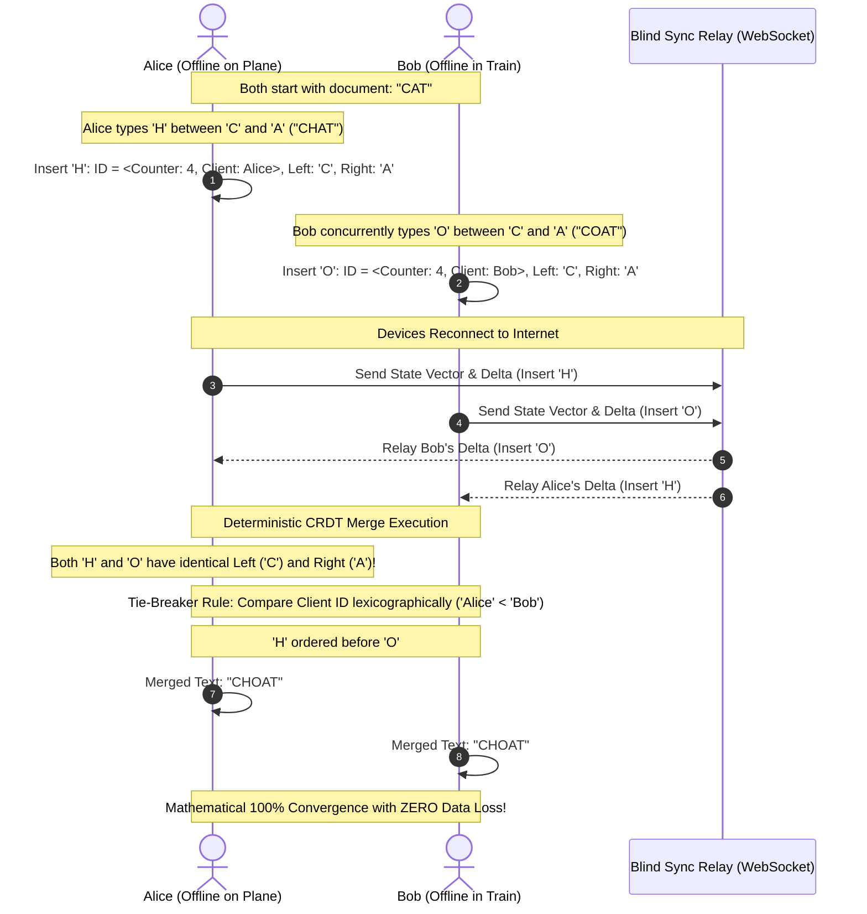

# Local-First Software, Offline-First Architecture, and Decentralized Sync

---

## 💡 Intuitive Mental Model: The Personal Leather Notebook vs. The Office Whiteboard

### 1. The Cloud-First Office Whiteboard (Google Docs / Standard SaaS):
- Imagine you and 5 colleagues work by looking at a single shared whiteboard mounted inside a corporate office building.
- Every time you want to draw a mark or write a word, you must shout over a radio to an office guard: *"Guard, please write the letter 'A' on line 4!"*
- If the radio loses signal for 2 seconds (airplane flight, subway tunnel, elevator), **your pen stops working**. You cannot write a single word.
- If the office building catches fire or the company revokes your badge, **every note you ever wrote in your entire life vanishes permanently**.

### 2. The Local-First Leather Notebook (Ink & Switch / CRDTs):
- You carry your own physical, hardcover leather notebook in your pocket wherever you go.
- When you have an idea, you touch your pen to the paper. **The ink flows in zero milliseconds with zero network spinners.**
- You can hike into the Grand Canyon for two weeks with no internet, writing dozens of pages.
- When you return to civilization and sit down with your colleague over coffee, you both open your notebooks.
- You follow a simple mathematical rule: *"Every paragraph has a unique author tag and sequence ID. If we both added notes to Section 3, we cleanly weave our sentences together without erasing either person's work."*
- **You own your notebook forever.** Even if the cloud company goes bankrupt, your local files continue to run for decades!

---

## 👶 Plain-English / ELI5 Overview

Almost every modern web app is built backwards:
- Your laptop or phone is treated like a "dumb terminal" with a screen.
- Every button click, search, and keystroke sends a message over the internet to a server in Virginia, waits for an answer, and shows a loading spinner. If your Wi-Fi blinks, the app freezes.

**Local-First flips this architecture around:**
1. All your data lives **directly inside your phone or laptop** in a super-fast embedded database (like SQLite).
2. Reads and writes take **zero milliseconds** because your app never waits for the network.
3. When internet is available, your device syncs with other devices in the background using mathematical merging structures called **CRDTs (Conflict-free Replicated Data Types)**.
4. If two people edit the same document while offline, the computers automatically merge the changes without any data loss or "Which version do you want to keep?" dialog boxes!

---

## ⚠️ The Horror Scenarios: What Breaks Without Proper Design?

### 1. The Last-Write-Wins (LWW) Data Clobbering Catastrophe
A sales executive spends an entire 6-hour flight preparing a 40-page contract amendment offline.
*The Catastrophe:* While the executive was airborne, an assistant back at headquarters opened the document and fixed a single comma in the title.
*The Failure:* Upon landing, the executive's laptop connects to airport Wi-Fi. The backend REST API uses a naive Last-Write-Wins strategy: `UPDATE contracts SET content = $1 WHERE id = 12`. Because the assistant's save had a later wall-clock timestamp on the server, the server rejects the executive's payload or silently overwrites it. **6 hours of legal drafting are permanently clobbered and lost forever!**

### 2. The CRDT Memory Tombstone Avalanche
A collaborative document startup builds a web editor using a naive sequence CRDT.
*The Catastrophe:* In sequence CRDTs, when a user deletes a character, the system cannot simply remove the node from memory—it must retain an invisible **Tombstone** so that concurrent edits from offline peers know where to attach.
*The Failure:* Over 6 months of active editing, users type and backspace millions of words. The document text is only 10 KB, but the internal CRDT tree retains **8,000,000 tombstone objects**, consuming 1.2 GB of RAM! Opening the document crashes mobile Safari and Chrome tabs across all devices.

### 3. The Offline Schema Migration Split-Brain
An engineering team deploys version 2.0 of their local-first application, restructuring a database table from `name: string` to `first_name: string, last_name: string`.
*The Catastrophe:* A mobile client remains offline for 3 weeks on version 1.0, generating hundreds of local client records with the old schema.
*The Failure:* When the client reconnects, the cloud sync relay rejects the incoming binary deltas because they violate the new schema. The client cannot receive server updates, cannot push local updates, and enters a permanent sync deadlock.

---

## 1. The Local-First Paradigm Shift

For decades, the dominant web paradigm was the **Cloud-First Thin Client**: all application state resides on centralized cloud databases, and clients are stateless renderers executing HTTP RPCs.

### Pathologies of Cloud-First Architecture:
1. **The Spinner Tax:** Every keystroke, button click, or navigation requires a network round-trip time ($\text{RTT} \ge 50-200\text{ ms}$), introducing UI latency and modal loading spinners.
2. **Offline Fragility:** Severing the network connection renders the application completely frozen and non-functional.
3. **Data Hostage Crisis:** If the SaaS provider goes out of business, changes terms, or revokes account access, user data disappears permanently.

### The 7 Ink & Switch Local-First Principles (Kleppmann et al., 2019):
```
+---------------------------------------------------------------------------------+
|                   THE 7 LOCAL-FIRST ARCHITECTURAL IDEALS                        |
|                                                                                 |
| 1. No Spinners: Immediate local read/write on disk/memory (< 16ms frame budget) |
| 2. Multi-Device: Transparent cross-device synchronization                       |
| 3. Offline Native: Seamless continuous work anywhere without internet           |
| 4. Collaboration: Real-time multiplayer synchronization when peers connect      |
| 5. Longevity: Software and files continue to function for decades offline      |
| 6. User Agency: Users own and control their data in standard open formats       |
| 7. Security & Privacy: End-to-end encryption by default; untrusted cloud relays |
+---------------------------------------------------------------------------------+
```

---

## 2. Core Tripartite Architecture

A production local-first system is partitioned into three decoupled layers:

```
+-------------------------------------------------------------------------------+
|                          LOCAL-FIRST ARCHITECTURE                             |
|                                                                               |
|  [ Client Device A ]                                   [ Client Device B ]    |
|  +--------------------+                               +--------------------+  |
|  | Fast UI Engine     |                               | Fast UI Engine     |  |
|  +---------+----------+                               +---------+----------+  |
|            |                                                    |             |
|  +---------v----------+                               +---------v----------+  |
|  | Local DB (SQLite/  |                               | Local DB (SQLite/  |  |
|  | IndexedDB/WASM)    |                               | IndexedDB/WASM)    |  |
|  +---------+----------+                               +---------+----------+  |
|            |                                                    |             |
|  +---------v----------+                               +---------v----------+  |
|  | Local CRDT Engine  |                               | Local CRDT Engine  |  |
|  | (Yjs / Automerge)  |<====== Sync Protocol ========>| (Yjs / Automerge)  |  |
|  +---------+----------+        (WebRTC P2P)           +---------+----------+  |
|            |                                                    |             |
|            +-------------------+        +-----------------------+             |
|                                |        |                                     |
|                                v        v                                     |
|                     +----------------------+                                  |
|                     | Untrusted Blind Sync |                                  |
|                     | Server (E2EE Relay)  |                                  |
|                     +----------------------+                                  |
+-------------------------------------------------------------------------------+
```

1. **Local Persistent Storage Engine:** Embedded database running inside the client process (SQLite compiled to WASM on Web via OPFS, Native SQLite on iOS/macOS/Android, or IndexedDB/LMDB).
2. **Local CRDT Sync Kernel:** In-memory conflict-free replicated data type engine (e.g., Yjs, Automerge, Loro) capturing document state mutations as deterministic commutative operations.
3. **Untrusted Blind Sync Relay:** Centralized or distributed broker that stores and forwards encrypted CRDT delta blobs without having cryptographic access to decrypt plaintext content.

---

## 3. Conflict Resolution Protocols: State-Based vs. Op-Based CRDTs

When disconnected devices concurrently mutate the same document offline, conventional databases fail with locking errors or silent last-write-wins data loss. Local-first engines use **CRDTs (Conflict-free Replicated Data Types)** to guarantee **Strong Eventual Consistency (SEC)**.

### Mathematical Equivalence of SEC
Given any two replica states $S_A, S_B$, after exchanging all operations:
$$S_A \star S_B = S_B \star S_A \implies \text{Merge is Commutative, Associative, and Idempotent}$$

### State-Based (CvRDT) vs. Operation-Based (CmRDT)
* **CvRDT (Convergent / Lattice Join):** Replicas transmit their entire state (or state deltas). Merge computes the least upper bound ($\sqcup$) on a join-semilattice:
$$S_{\text{merged}} = S_A \sqcup S_B$$
* **CmRDT (Commutative Operations):** Replicas transmit fine-grained mutation operations across a reliable causal broadcast channel. If operations commute ($o_1 \circ o_2 = o_2 \circ o_1$), every replica arrives at identical state.

### Automerge vs. Yjs Structural Approaches
* **Automerge (B-Tree Trace DAG):** Every character insertion is an object identified by a Lamport timestamp `(counter, actor_id)`. Tracks full edit history as an immutable DAG, allowing time-travel debugging.
* **Yjs (YATA - Yet Another Transformation Approach):** Formats documents as double-linked item lists with compact binary encoding and run-length compression of continuous keystrokes, reducing memory footprint by up to $10\times$.

---

## 4. 🚶 Step-by-Step Walkthrough: Alice & Bob Concurrently Edit Offline

Let us trace how two users resolve concurrent offline edits using a sequence CRDT without a central server:
- **Starting Document:** `"CAT"`
  - Character `C` has ID $\langle 1, \text{Root} \rangle$
  - Character `A` has ID $\langle 2, \text{Root} \rangle$
  - Character `T` has ID $\langle 3, \text{Root} \rangle$



1. **Local Offline Insertions:**
   - Alice creates item `H` with origin $\text{left} = \text{C}$, $\text{right} = \text{A}$, ID = $\langle 4, \text{Alice} \rangle$.
   - Bob creates item `O` with origin $\text{left} = \text{C}$, $\text{right} = \text{A}$, ID = $\langle 4, \text{Bob} \rangle$.
2. **Synchronization Handshake:** Upon reconnecting, both devices exchange their binary operation logs via the sync relay.
3. **Deterministic Tie-Breaking:**
   - Both items claim the exact same insertion position between `C` and `A`.
   - The CRDT applies a deterministic total ordering rule (e.g., comparing Lamport timestamps, then client IDs: `"Alice" < "Bob"`).
4. **Guaranteed Convergence:** Both Alice and Bob's screens render the exact identical string `"CHOAT"`. Zero user dialog prompts, zero server locks, and zero data lost!

---

## 5. Log-Structured Replication & Revision Trees (CouchDB Protocol)

Before CRDTs became widespread, CouchDB and PouchDB pioneered log-structured offline document sync using **MVCC Revision Trees**.

### The `_rev` Generation Algorithm
Every document mutation produces a deterministic revision string:
$$\text{rev} = \langle \text{generation-int} \rangle - \mathcal{H}(\text{payload} \parallel \text{parent-rev})$$
* Example: `1-4c6114...` $\to$ `2-cfbee6...`.

### Branching and Conflict Resolution
```
                   +---> rev: 2-A (Alice offline update)
                  /
   rev: 1-root --+
                  \
                   +---> rev: 2-B (Bob offline update)
```
1. When Alice and Bob edit revision `1-root` concurrently offline, CouchDB records both branches in a local tree rather than discarding one.
2. **Deterministic Winner:** CouchDB chooses the active revision deterministically using lexicographical comparison of hash digests:
$$\text{Active} = \max(\text{rev}_{2\text{-A}}, \text{rev}_{2\text{-B}})$$
3. **Application Merge:** The conflict remains recorded in metadata until the client application fetches conflicting revisions and writes a new resolution revision `3-C` that explicitly deletes or merges the conflicting leaves.

---

## 6. Efficient Wire Protocols: Version Vectors and State Vector Exchanges

Transmitting full document history over constrained mobile networks is prohibitive. Local-first protocols use **State Vectors** to calculate minimal diffs.

### State Vector Definition
A mapping of Actor IDs to the highest contiguous sequence number observed from that actor:
$$V = \{ \text{Actor}_1 \mapsto s_1, \; \text{Actor}_2 \mapsto s_2, \; \dots, \; \text{Actor}_n \mapsto s_n \}$$

### Two-Step Sync Handshake
```
   Client A                                                 Client B
   [ State Vector: {A:12, B:8} ]                            [ State Vector: {A:10, B:15} ]
         |                                                        |
         | -------- Step 1: Send State Vector $V_A$ ------------> |
         |                                                        |
         |                                                        | Compute Delta:
         |                                                        | What does B have that
         |                                                        | A does not? (B: 9..15)
         |                                                        |
         | <------- Step 2: Return Encoded Delta ---------------- |
         |                                                        |
   Apply Delta(B: 9..15)                                          |
   Update $V_A = \{A:12, B:15\}$                                  |
```

This exchange requires strictly **one RTT**, sending only the binary delta operations missing on the remote side.

---

## 7. Zero-Knowledge Cloud Storage & Cryptographic Capabilities

In local-first systems, the central server is treated as an **untrusted, hostile relay** (Zero-Trust Storage):

```
+---------------------------------------------------------------------------------+
|                         ZERO-KNOWLEDGE RELAY PATTERN                            |
|                                                                                 |
|  [ Client A ]                                              [ Client B ]         |
|  1. Plaintext State                                        1. Decrypt with Key  |
|  2. Encrypt: AES-GCM-256(State, Key)                       2. Merge CRDT Delta  |
|  3. Sign: Ed25519(EncryptedBlob)                           3. Verify Signature  |
|         |                                                        ^              |
|         +-----------------------+        +-----------------------+              |
|                                 |        |                                      |
|                                 v        |                                      |
|                      +------------------------+                                 |
|                      | Untrusted Cloud Relay  |                                 |
|                      | - Blind key-value store|                                 |
|                      | - Cannot read data     |                                 |
|                      | - Verifies auth tokens |                                 |
|                      +------------------------+                                 |
+---------------------------------------------------------------------------------+
```

### UCANs (User Controlled Authorization Networks)
Instead of central OAuth servers issuing opaque bearer tokens, clients issue decentralized cryptographic capabilities:
1. **Keypairs as Identities:** Users are identified by `did:key:z6Mku...` (Ed25519 public keys).
2. **Delegation Chains:** Alice can sign a cryptographic token delegating read access for path `/notes/work/*` to Bob for 48 hours without involving any server.
3. **Attenuation:** Bob can attenuate permissions (e.g., read-only, specific sub-folder) and delegate them to a read-only backup device.

---

## 8. Real-World Architectural Case Studies

### 8.1 Linear's Client-Side Sync Engine
* **Local Architecture:** Linear maintains an in-memory graph of all issues, users, and teams inside the browser, backed by IndexedDB.
* **Optimistic Execution:** All UI actions apply synchronously in zero milliseconds; changes are buffered in an SQLite/IndexedDB mutation queue.
* **WebSocket Transaction Protocol:** The queue flushes mutations as atomic transactions over WebSockets. The server validates constraints, writes to Postgres, and broadcasts the diff to all subscribed clients.

### 8.2 Figma Multiplayer Engine
* **Hybrid Model:** Figma uses a central authoritative C++ server cluster to enforce scene graph integrity, but uses client-side optimistic trees for local transforms.
* **Fractional Indexing:** Ordering of canvas layers uses fractional indices (e.g., between index `a0` and `a1`, insert `a0.5`), preventing expensive shifts of sibling element arrays.

---

## 9. ⚖️ Practical Trade-Offs & Rules of Thumb

| Architectural Dimension | Local-First (CRDT / SQLite WASM) | Cloud-First Thin Client (REST / GraphQL) | Centralized Collaborative (Figma / Google Docs OT) |
| :--- | :--- | :--- | :--- |
| **Interaction Latency** | **Instant ($< 1\text{ ms}$):** Disk/RAM bound. | Network bound ($50 - 300\text{ ms}$). | Instant local optimistic, server reconciles. |
| **Offline Capability** | **100% Full Functionality:** Read and write. | Zero functionality (Loading spinners). | Limited caching; drops out without server. |
| **Data Privacy & Ownership** | **E2EE Native:** Cloud is a blind blob store. | Cloud vendor can inspect all records. | Cloud vendor holds plaintexts in RAM. |
| **Memory Footprint** | Higher (Maintains CRDT metadata & local DB). | Minimal (Only active view state in memory).| Moderate. |
| **Schema Migrations** | Complex (Must support heterogeneous client versions).| Simple (Single centralized database migration).| Server transforms operations across schemas. |
| **Best Used For** | Note-taking, personal PKMs, CAD/design, mobile field tools. | High-compliance banking, multi-tenant B2B portals. | Dense collaborative canvases, shared spreadsheets. |

---

## 🎯 Top Real-World Interview Questions & Deep-Dive Answers (FAANG / Staff Level)

### Question 1: Operational Transformation (OT) vs. Conflict-free Replicated Data Types (CRDTs): Why did Google Docs choose OT while modern collaborative apps (Linear, Apple Notes) choose CRDTs?

#### The Interviewer's Trap
Candidates often say: *"CRDTs are newer and strictly better than OT."* This ignores the profound memory and computational trade-offs that caused Google Docs to maintain OT for nearly two decades.

#### Comprehensive Architectural Comparison
1. **Operational Transformation (OT):**
   - *Architecture:* Requires a **central authoritative server** to establish a canonical total order of operations.
   - *Mechanics:* Client operations are transformed against concurrent operations based on server revision logs:
     $$\text{Transform}(op_1, op_2) \to (op_1', op_2')$$
   - *Advantage (Zero Memory Overhead):* OT stores **zero metadata** in the document itself. A 10 MB document is just 10 MB of plain text. There are no tombstones, no GUIDs per character, and no Lamport timestamps.
   - *Disadvantage:* Extremely fragile without a central server. Peer-to-peer decentralized OT requires complex $N$-way transformation functions ($TP_2$) which were proven mathematically incorrect in multiple published papers.
2. **Conflict-free Replicated Data Types (CRDTs):**
   - *Architecture:* **Fully decentralized and peer-to-peer native**. No central server required.
   - *Mechanics:* Every mutation is mathematically commutative. Merging produces the identical state regardless of arrival order.
   - *Historical Bottleneck:* Naive CRDTs had massive memory amplification ($20\times$ to $50\times$) due to character IDs and tombstones.
   - *The Modern Turning Point:* Breakthroughs like **Yjs (YATA)**, **Automerge binary columnar encoding**, and **Loro** reduced CRDT memory overhead to just $1.5\times - 2\times$ of plain text, enabling CRDTs to replace OT in mobile, desktop, and web applications.

---

### Question 2: Why did Figma deliberately avoid pure decentralized P2P CRDTs in favor of a centralized authoritative server with fractional indexing?

#### Staff-Level Analysis of 2D Scene Graphs
1. **The Nature of 2D Design Documents:**
   - Unlike text documents (which are 1-dimensional sequences of characters), design tools like Figma manipulate a **2D hierarchical scene graph** (Frames $\to$ Groups $\to$ Vectors $\to$ Fills).
   - In a 2D scene graph, operations must enforce strict invariants:
     - An object cannot be moved inside its own child (preventing tree cycles).
     - Object bounding boxes must recompute synchronously when constraints change.
2. **Why Pure P2P CRDTs Struggle with Scene Trees:**
   - Resolving tree moves concurrently across offline peers in pure CRDTs often produces tree cycles ($A$ inside $B$ while $B$ inside $A$) or duplicated nodes, requiring heavy algorithmic repair logic.
3. **Figma's Hybrid Architecture:**
   - **Central Authority:** Figma routes all multiplayer edits through a central authoritative C++ server cluster. The server sequences mutations and guarantees scene graph integrity.
   - **Fractional Indexing for Layer Ordering:**
     - Instead of integer indices (`layer: 0, 1, 2`), Figma assigns string keys (`a0`, `b0`).
     - Inserting between `a0` and `b0` produces `a0.5`.
     - This allows multiple users to reorder layers concurrently without re-indexing or shifting sibling array positions!

---

### Question 3: How do production CRDT engines (Yjs, Automerge, Loro) solve the "Tombstone Garbage Collection" problem without breaking causal consistency for offline peers?

#### The Deletion Paradox in Distributed CRDTs
- If Alice deletes the word `"hello"`, and the engine immediately frees the memory for those 5 character structs, what happens if Bob reconnects after 2 weeks offline and sends an insertion: *"Insert 'world' after character 'o'"*?
- If the struct for `'o'` was deleted, Alice's engine cannot determine where to attach Bob's new text, causing silent corruption.

#### Production Garbage Collection Techniques
1. **Run-Length Struct Merging (Yjs / Loro):**
   - Instead of allocating 1 object per deleted character, contiguous deleted items are merged into a single compact run-length struct:
     $$\text{Item}\{\text{origin}: C_1, \ \text{length}: 500, \ \text{deleted}: \text{true}\}$$
   - Compresses thousands of tombstones into a 24-byte binary record, reducing memory by $99\%$.
2. **Stable Vector GC (State-Based Pruning):**
   - If the system has an untrusted sync relay or known set of peers, peers periodically broadcast their **Stable State Vectors** (the minimum contiguous sequence received by *all* active devices).
   - If a deleted item has a Lamport timestamp strictly older than $\min(\text{All Active State Vectors})$, no active peer can ever generate an operation referencing that tombstone!
   - The engine safely purges the tombstone from disk and memory forever.

---

### Question 4: How do you handle schema migrations and multi-tenant authorization in an offline-first, end-to-end encrypted local-first database?

#### Architectural Solution
1. **Schema Evolution via Additive Documents:**
   - Traditional databases execute destructive in-place migrations: `ALTER TABLE users DROP COLUMN name`.
   - In local-first systems, schema evolution must be strictly **additive and forward-compatible**:
     - Keep old fields deprecated; add new fields with defaults.
     - Employ document lens transformations (Cambria project by Ink & Switch): write bidirectional lenses that dynamically translate CRDT binary deltas between Schema v1 and Schema v2 on the fly.
2. **Zero-Knowledge Multi-Tenant Authorization:**
   - Because the cloud relay is untrusted and cannot read plaintext data, it cannot enforce traditional database row-level security (RLS) SQL policies.
   - **Cryptographic Capability Delegation (UCANs):**
     - Each document or collection is encrypted with a symmetric Document Key ($K_{\text{doc}}$).
     - Access tokens are signed JWT-like UCAN tokens: Alice signs a delegation token granting Bob's public key (`did:key:...`) permission to append encrypted blobs to Channel ID `doc_789` until timestamp $T$.
     - The cloud relay verifies the Ed25519 cryptographic signature of the UCAN token before storing or forwarding the encrypted delta, enforcing authorization without ever seeing user data!
