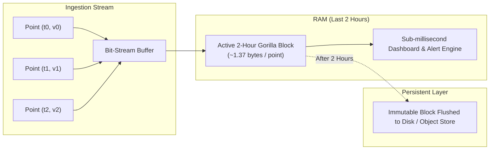

# Time-Series Databases (TSDB) & Facebook's Gorilla Compression Architecture

Time-series data is the telemetry backbone of modern infrastructure. Every server, container, microservice, sensor, and financial instrument continuously emits streams of timestamped measurements. At FAANG scale, this translates to hundreds of millions of data points arriving every single second. Traditional relational databases (RDBMS) and document stores buckle under this write volume; keeping raw uncompressed points in memory would cost millions of dollars in RAM. 

Facebook's landmark 2015 paper—*Gorilla: A Fast, Scalable, In-Memory Time Series Database* (Pelkonen et al., VLDB 2015)—revolutionized this domain by introducing streaming bit-level compression algorithms that compress 16-byte `(int64_timestamp, float64_value)` tuples down to an astonishing average of **1.37 bytes** ($\approx 12\times$ reduction), allowing petabytes of recent monitoring data to be queried directly from RAM with sub-second latencies.

Related Hands-On Runnable Lab:
* [`28_gorilla_tsdb_compression/`](file:///home/prasanta/Documents/learning_folder/system_design/12_HANDS_ON_RUNNABLE_LABS/28_gorilla_tsdb_compression/)

---

## 💡 Intuitive Real-World Physical Analogies

### 1. The Marathon Runner's Heartbeat vs. Full GPS Logs (Delta-of-Delta)
Imagine tracking a runner during a marathon. 
* **The Naive Way:** Every minute, you write down their full GPS coordinates and the exact atomic clock timestamp: `"2026-10-22 14:15:00 UTC, Latitude 40.712776, Longitude -74.005974"`. By mile 26, your notebook is overflowing with huge, repetitive numbers.
* **The Gorilla Way:** You know the runner is checked every 60 seconds like clockwork. 
  * Mile 1 check was at 60s. Mile 2 check was at 120s (difference = 60s).
  * Mile 3 check was at 180s (difference = 60s). 
  * The difference between the differences (*delta-of-delta*) is $60 - 60 = 0$.
  * Instead of writing the full 8-byte timestamp, you just jot down a single tick mark: `0` (1 bit). You only spend extra ink when the runner slows down or stumbles.

### 2. The Thermal Security Camera (Floating-Point XOR)
Imagine a thermal camera monitoring an empty data center server room.
* The temperature fluctuates microscopically: $72.0001^\circ\text{F} \to 72.0003^\circ\text{F} \to 72.0002^\circ\text{F}$.
* In binary floating-point representation, the high-order bits representing `"72 degrees"` remain 100% identical. Only the tiniest sub-fractional bits at the tail wiggle.
* If you take the current reading and lay it directly over the previous reading (XOR), the identical high bits cancel out completely, turning into a massive sea of zeros. Gorilla simply throws away all those leading zeros and only writes the tiny flickering bits in the middle.

### 3. The Library Subject Index vs. The Infinite Card Catalog (Inverted Index)
Imagine a library where every book has tags: `genre="scifi"`, `author="Asimov"`, `language="english"`.
* If someone asks: *"Give me all English sci-fi books by Asimov"*, you don't scan all 5,000,000 books from cover to cover.
* You open three index drawers:
  - Drawer 1 (`genre="scifi"`): List of book numbers `[12, 45, 99, 104, ...]`
  - Drawer 2 (`author="Asimov"`): List of book numbers `[45, 99, 203, ...]`
  - Drawer 3 (`language="english"`): List of book numbers `[12, 45, 99, 310, ...]`
* You intersect these lists in memory using bitwise AND (`Roaring Bitmaps`) in microseconds. This is how Prometheus, VictoriaMetrics, and Gorilla resolve metric queries across millions of streams.

---

## 👶 Plain-English / ELI5 Overview

A **Time-Series Database (TSDB)** is a database built specifically for numbers that change over time (like CPU usage, memory percentage, stock prices, or temperatures).

In regular monitoring, two things are almost always true:
1. **Time moves predictably:** If a monitoring agent scrapes your server every 15 seconds, the next timestamp is almost guaranteed to be exactly 15 seconds after the last one.
2. **Values change smoothly:** If your CPU is at $45.2\%$, it is very unlikely to be $9,482,104\%$ in the next second. It will be $45.3\%$ or $45.1\%$.

Standard databases (like MySQL or MongoDB) store every point as a raw 8-byte timestamp plus an 8-byte decimal number ($16\text{ bytes}$). If you collect 100,000,000 metrics per second across a fleet of 50,000 microservices, storing that in RAM uncompressed would eat **1.6 Gigabytes every single second**, or **138 Terabytes of RAM every day**.

**Facebook's Gorilla solves this with two clever bit-level tricks:**
1. **Delta-of-Delta for Time:** Instead of storing the timestamp, it stores how much the *interval* changed. If the interval didn't change (still 15 seconds), it stores a single binary `0` bit!
2. **XOR for Values:** It compares the current number with the previous number using binary XOR. Identical numbers become `0`. Numbers that barely changed have their identical parts erased, leaving only a tiny handful of bits.

The result? Instead of 16 bytes ($128\text{ bits}$), each point takes an average of **1.37 bytes** ($\approx 11\text{ bits}$). Now, Facebook can hold weeks of real-time monitoring data in RAM on standard servers, enabling dashboards to render in milliseconds.

---

## ⚠️ The Horror Scenario: The Black Friday High-Cardinality Meltdown

An enterprise e-commerce platform with $100\text{M}$ active shoppers was gearing up for Black Friday. Their engineering team maintained a centralized Prometheus + Grafana cluster to monitor checkout microservices across $5,000$ Kubernetes nodes.

```mermaid
sequenceDiagram
    autonumber
    participant Dev as Junior Developer
    participant K8s as K8s Cluster (5,000 Nodes)
    participant TSDB as Centralized TSDB (Prometheus)
    participant OOM as Linux Kernel OOM Killer
    participant Alert as PagerDuty / SRE

    Dev->>K8s: Deploys "enhanced checkout telemetry" commit
    Note over Dev,K8s: Added tag: http_requests_total{..., user_id="UUID", cart_id="UUID"}
    K8s->>TSDB: 250,000 pods emit 50M metrics/sec with unique user_ids
    Note over TSDB: Inverted Index cardinality churn explodes!<br/>Active series jumps from 2M to 180M within 8 minutes!
    Note over TSDB: Postings lists fragment memory.<br/>Head block RAM usage spikes from 64 GB to 512 GB!
    TSDB->>TSDB: In-memory allocations stall; GC pause hits 45 seconds
    TSDB--xAlert: Scrapes time out; alerting engine stops processing rules!
    OOM->>TSDB: SIGKILL (Out of Memory)
    Note over TSDB,Alert: TSDB crash loops on WAL replay.<br/>SREs are 100% blind during the largest checkout outage of the year!
```

### What Went Catastrophically Wrong?
1. **The High-Cardinality Explosion:** The developer introduced `user_id` ($100\text{M}$ unique values) into the time-series label set. In a TSDB, every unique combination of key-value tags creates a brand new *time series* with its own postings list and ring buffer.
2. **Index Fragmentation & RAM Exhaustion:** The inverted index blew past $500\text{ GB}$ of RAM. Postings lists could no longer fit in CPU L3 cache or physical memory.
3. **The WAL Replay Death Loop:** When Prometheus crashed due to OOM, it tried to replay the write-ahead log (WAL) on restart. Because the WAL contained the same millions of high-cardinality series, the process immediately hit OOM again, resulting in an unrecoverable 3-hour blind outage.

---

## 1. The Anatomy of Time-Series Workloads

Time-series data is fundamentally different from transactional relational data or analytical warehouse data:
$$\text{Point} = \langle \text{MetricName}, \; \{\text{Tag}_k = \text{Value}_k\}, \; \text{Timestamp } t, \; \text{Value } v \rangle$$

```
+-------------------------------------------------------------------------------+
|                       ANATOMY OF A TIME-SERIES POINT                          |
|                                                                               |
|  Identifier (TSID):                                                           |
|  sys.cpu.user {host="web-01", region="us-east-1", env="prod"}                 |
|                                                                               |
|  Data Stream (Appended sequentially):                                         |
|  +---------------------------+---------------------------+                    |
|  | Timestamp t_0 (uint64)    | Value v_0 (float64)       | -> 16 bytes        |
|  | Timestamp t_1 (uint64)    | Value v_1 (float64)       | -> 16 bytes        |
|  | Timestamp t_2 (uint64)    | Value v_2 (float64)       | -> 16 bytes        |
|  +---------------------------+---------------------------+                    |
+-------------------------------------------------------------------------------+
```

### Unique Workload Characteristics:
1. **Append-Dominant & Write-Heavy:** Billions of metrics ingested per second from microservices, IoT devices, and infrastructure probes. In-place updates and random deletes are virtually non-existent.
2. **Strict Time Ordering:** $\approx 99\%$ of incoming writes are for the immediate current epoch $[t_{\text{now}} - \epsilon, t_{\text{now}}]$. Out-of-order writes are rare and bounded by narrow windows.
3. **Decaying Query Utility:** Recent data (last 2 hours) is queried continuously with sub-second latency for alerting and dashboards. Older data is accessed via aggregate rollups (1-minute, 1-hour downsampled averages) or compliance retention policies.
4. **The High-Cardinality Explosion:** High-dimensional label combinations (e.g., `user_id`, `container_id`, `ip_address`) generate millions of unique time series, exhausting memory in naive index engines.

---

## 2. Facebook Gorilla In-Memory TSDB Compression

In 2015, Facebook published *Gorilla: A Fast, Scalable, In-Memory Time Series Database* (Pelkonen et al., VLDB 2015). Gorilla introduced two lossless compression algorithms that reduced 16-byte `(int64_timestamp, float64_value)` pairs to an average of **1.37 bytes** ($\approx 12\times$ compression factor), allowing Facebook to keep tens of billions of points in RAM.

```
+-------------------------------------------------------------------------------+
|                       GORILLA DATA STREAM COMPRESSION                         |
|                                                                               |
| Raw Data Point:      Timestamp (8 bytes / 64 bits) + Value (8 bytes / 64 bits)|
| Compressed Stream:   [Header: First Timestamp (32b)] [First Value (64b)]      |
|                      Followed by bit-packed variable-length compressed stream |
| Compressed Size:     ~1.37 bytes per point average                            |
+-------------------------------------------------------------------------------+
```

### In-Memory Block Architecture:
Gorilla partitions data into **2-hour time slices**. Each active time series has an in-memory byte buffer holding its 2-hour compressed block:
* At $t = 0$, an open block is created. The first timestamp is stored with 32-bit Unix epoch precision. The first float64 value is stored raw (64 bits).
* Subsequent points are appended bit-by-bit using streaming bit-writers.
* At $t = 2\text{ hours}$, the block is closed, marked immutable, and flushed to persistent distributed storage (GlusterFS / disk), and a fresh 2-hour block opens.



---

## 3. Timestamp Compression: Delta-of-Delta Encoding

In regular monitoring, metrics are scraped at periodic intervals (e.g., every 15, 30, or 60 seconds). Therefore, consecutive timestamps $t_0, t_1, t_2, \dots$ have nearly identical first-order differences:
$$D = t_i - t_{i-1} \approx 60$$

Gorilla computes the **delta-of-delta** ($D'$):
$$D' = (t_i - t_{i-1}) - (t_{i-1} - t_{i-2}) = D_i - D_{i-1}$$

For strictly regular metrics, $D' = 0$. Gorilla encodes $D'$ using variable-length prefix bit-codes:

```
+-----------------------------------------------------------------------------+
|                     DELTA-OF-DELTA ENCODING RULES                           |
|                                                                             |
| Case 1: D' = 0                                                              |
|   Emit: '0' (1 bit)                                                         |
|                                                                             |
| Case 2: -63 <= D' <= 64  (7 bits)                                           |
|   Emit: '10' (2 bits) + 7-bit binary representation of D'                   |
|                                                                             |
| Case 3: -255 <= D' <= 256  (9 bits)                                         |
|   Emit: '110' (3 bits) + 9-bit binary representation of D'                  |
|                                                                             |
| Case 4: -2047 <= D' <= 2048  (12 bits)                                      |
|   Emit: '1110' (4 bits) + 12-bit binary representation of D'                |
|                                                                             |
| Case 5: Out of bounds (Extreme jitter or clock reset)                       |
|   Emit: '1111' (4 bits) + 32-bit exact binary representation of D'          |
+-----------------------------------------------------------------------------+
```

### Step-by-Step Numerical Walkthrough:
Consider 5 consecutive scrapes with slight network jitter:
* $t_0 = 1600000000$ (Stored as 32-bit header)
* $t_1 = 1600000060 \implies D_1 = 60$ (Stored as 14-bit raw delta in block header)
* $t_2 = 1600000120 \implies D_2 = 60$:
  * $D'_2 = D_2 - D_1 = 60 - 60 = 0$
  * **Emitted bits:** `0` (Only 1 bit!)
* $t_3 = 1600000182 \implies D_3 = 62$:
  * $D'_3 = D_3 - D_2 = 62 - 60 = +2$
  * Fits in Case 2 ($-63 \le D' \le 64$).
  * Binary of $+2$ in 7 bits is `0000010`.
  * **Emitted bits:** `10` + `0000010` = `100000010` (9 bits total).
* $t_4 = 1600000242 \implies D_4 = 60$:
  * $D'_4 = D_4 - D_3 = 60 - 62 = -2$
  * Fits in Case 2. In 7-bit two's complement / signed magnitude: $-2 \to$ `1111110`.
  * **Emitted bits:** `10` + `1111110` (9 bits total).

**Compression Efficiency:** In a typical production cluster where $96\%$ of scrapes occur on time, $96\%$ of timestamps consume **exactly 1 single bit** instead of 64 bits!

---

## 4. Value Compression: Floating-Point XOR Encoding

Time-series metric values (e.g., CPU load, memory usage, request counts) are stored as IEEE 754 64-bit floating-point numbers:
$$\text{IEEE 754: } [1\text{ bit sign}] \parallel [11\text{ bits exponent}] \parallel [52\text{ bits mantissa}]$$

```
+---+---------------+----------------------------------------------------+
| S | Exponent (11) | Mantissa / Fraction (52 bits)                      |
+---+---------------+----------------------------------------------------+
 63  62           52 51                                                 0
```

Consecutive values are often identical or change very little. Therefore, their bitwise XOR difference contains extensive sequences of leading and trailing zeros:
$$\text{XOR} = v_i \oplus v_{i-1}$$

```
+-------------------------------------------------------------------------------+
|                       FLOAT64 XOR BIT-PACKING RULES                           |
|                                                                               |
| Step 1: Compute X = v_i ^ v_{i-1}                                             |
|                                                                               |
| Step 2: If X == 0 (Value has not changed):                                    |
|         Emit bit '0' (1 bit total)                                            |
|                                                                               |
| Step 3: If X != 0:                                                            |
|         Emit bit '1'                                                          |
|                                                                               |
|   Subcase A (Reusable Zero Window):                                           |
|     If leading_zeros(X) >= prev_leading AND trailing_zeros(X) >= prev_trailing|
|     Emit bit '0'                                                              |
|     Emit meaningful bits of X from prev_leading to (64 - prev_trailing)       |
|                                                                               |
|   Subcase B (New Zero Window):                                                |
|     Emit bit '1'                                                              |
|     Emit 5 bits: count of leading zeros (0..31)                               |
|     Emit 6 bits: length of meaningful bits (1..64)                            |
|     Emit meaningful bits of X                                                 |
|     Update prev_leading, prev_trailing                                        |
+-------------------------------------------------------------------------------+
```

### Complete Bit-Level Demonstration:
Let Value 1 ($v_0$) = `12.0` and Value 2 ($v_1$) = `12.5`:

```
Value 1 (12.0):
01000000 00101000 00000000 00000000 00000000 00000000 00000000 00000000

Value 2 (12.5):
01000000 00101001 00000000 00000000 00000000 00000000 00000000 00000000

XOR Result (v0 ^ v1):
00000000 00000001 00000000 00000000 00000000 00000000 00000000 00000000
|<- 15 leading 0s ->| 1 |<---------------- 48 trailing 0s ------------->|
```

* **Step 1:** $X \ne 0 \implies$ Emit bit **`1`**.
* **Step 2:** First non-zero value, must define window (Subcase B) $\implies$ Emit bit **`1`**.
* **Step 3:** 5 bits for leading zeros: $15 = \texttt{01111}_2$.
* **Step 4:** 6 bits for meaningful length: $1 = \texttt{000001}_2$.
* **Step 5:** Meaningful bits: Emit **`1`**.
* **Total bits emitted:** $1 + 1 + 5 + 6 + 1 = \mathbf{14\text{ bits}}$ (instead of 64 bits!).

Now consider Value 3 ($v_2$) = `12.25`:
```
Value 3 (12.25):
01000000 00101000 10000000 00000000 00000000 00000000 00000000 00000000

XOR Result (v1 ^ v2):
00000000 00000001 10000000 00000000 00000000 00000000 00000000 00000000
|<- 15 leading 0s ->| 11 |<--------------- 47 trailing 0s ------------->|
```
* Leading zeros = $15$, Trailing zeros = $47$.
* Since leading zeros ($15$) $\ge \text{prev\_leading}$ ($15$), and trailing zeros ($47$) $\ge \text{prev\_trailing}$ ($47 \approx 48$), if the window accommodates it, we use **Subcase A**:
* Emit bit **`1`** ($X \ne 0$), then bit **`0`** (reuse window), followed by the meaningful bits. No need to resend the 5-bit and 6-bit window headers!

---

## 5. High Cardinality & Inverted Index Architecture

A TSDB must index series identifiers so users can query by arbitrary tag selectors:
$$\texttt{http\_requests\_total\{service="payments", env="prod", status="500"\}}$$

```
+-------------------------------------------------------------------------------+
|                      INVERTED INDEX & POSTINGS LISTS                          |
|                                                                               |
| Tag Dimension: service="payments"                                             |
| Postings List: [ Series 101, Series 104, Series 209, Series 450, ... ]        |
|                                                                               |
| Tag Dimension: env="prod"                                                     |
| Postings List: [ Series 101, Series 102, Series 104, Series 300, ... ]        |
|                                                                               |
| Tag Dimension: status="500"                                                   |
| Postings List: [ Series 101, Series 104, Series 501, Series 708, ... ]        |
|                                                                               |
| Query Resolution (Bitwise AND across postings):                               |
| Result = [101, 104]  <=== Executed in microseconds using Roaring Bitmaps     |
+-------------------------------------------------------------------------------+
```

### The Cardinality Churn Problem
When ephemeral tags (e.g., Kubernetes `pod_id` or Git commit hashes) are introduced:
* Active series count surges into tens of millions.
* Postings lists grow unbounded, causing memory exhaustion and GC pauses.
* **Modern Solutions (VictoriaMetrics & Prometheus TSDB Block Compaction):**
  1. Immutable 2-hour head chunk blocks.
  2. Roaring Bitmap compression for postings lists.
  3. Disk-backed persistent LSM-style inverted indexes (TSM or DuckDB/Arrow columnar blocks).

---

## 6. Modern TSDB Storage Engines Comparison

| Architecture Dimension | Prometheus TSDB | InfluxDB (IOx Engine) | VictoriaMetrics | Facebook Gorilla | TimescaleDB |
| :--- | :--- | :--- | :--- | :--- | :--- |
| **In-Memory Buffer** | Head Chunk + Append-Only WAL | Arrow Record Batches | Custom MergeTree MemTable | Ring Buffer of 2-hr Blocks | PostgreSQL Shared Buffers |
| **On-Disk Format** | 2-hour compacted chunk directories | Apache Parquet on Object Storage | VictoriaMetrics Block (zstd) | Ephemeral RAM (Flushed to GlusterFS) | Relational Hypertables (Postgres heaps) |
| **Compression Scheme** | Double-delta + XOR (Gorilla derivative) | Parquet dictionary, Snappy/Zstd | Gorilla + Zstandard compression | Gorilla (Delta-of-delta + XOR) | Columnar chunk compression (Gorilla/Delta) |
| **Index Engine** | Inverted Postings Index | Apache DataFusion / Arrow In-Memory | Custom TSID Sparse Inverted Index | In-memory prefix Trie | B-Tree / BRIN Indexes |
| **High Cardinality Resilience** | Medium (bounded by RAM head) | High (Offloaded to Parquet metadata) | Very High (Fast disk paging) | Low (Strictly RAM-resident) | Medium (B-Tree size bloat) |
| **Out-of-Order Ingestion** | Bounded time window (e.g. 1-2 hrs) | Infinite (handled by Parquet merge) | Full support (LSM merge sort) | Strict rejection (must be in order)| Fully supported |

---

## 7. Real-World Production Battle-Testing

### 1. Meta (Facebook) Gorilla & Beringei
Meta open-sourced the C++ core of Gorilla under the name **Beringei**. In production at Meta:
* Handles **over 1 billion metrics ingested per second**.
* Keeps 26 hours of data in RAM across thousands of nodes.
* Read queries for real-time alerting return in under $10\text{ milliseconds}$.
* Reduced server fleet memory footprint by $88\%$ compared to their legacy HBase storage tier.

### 2. Uber's M3DB
Uber designed **M3DB** as a globally distributed, multi-region time-series engine using an evolution of Gorilla compression:
* Stores billions of concurrent metrics for trip dispatches, pricing surge algorithms, and driver apps.
* Encodes timestamps and floating-point values into M3-specific bitstreams with custom variable-byte markers.
* Solved the multi-tenant replication problem by marrying Gorilla blocks with a Raft-inspired distributed ring.

---

## 8. Practical Trade-Offs & Rules of Thumb

### When to Use Gorilla-Style Compression
1. **Strictly Regular Monitoring Workloads:** Ideal for Prometheus, Datadog agents, Telegraf, and CloudWatch metrics scraped at fixed intervals ($10\text{s}, 30\text{s}, 60\text{s}$).
2. **Sub-Second Dashboarding Requirements:** When queries need raw unaggregated data points from the last 2 hours to render Grafana graphs instantly.
3. **High Write-to-Read Ratios:** When $99.9\%$ of data points will never be read, but must be preserved cheaply in case an anomaly occurs.

### When NOT to Use Gorilla
1. **Irregular, Sporadic Events:** If timestamps arrive chaotically ($t_1=2\text{s}, t_2=840\text{s}, t_3=841\text{s}$), delta-of-delta encoding will constantly hit Case 5 ($1111$ + 32-bit integer), increasing storage size rather than shrinking it.
2. **Heavy Out-of-Order Scrapes:** Gorilla assumes strictly monotonic appends. If an IoT sensor uploads 5,000 buffered points from 3 hours ago, an in-memory Gorilla bit-stream cannot insert them into the middle without recompressing the entire block.
3. **String or High-Entropy Data:** Gorilla is designed strictly for IEEE 754 floats and integer timestamps. For log events or arbitrary JSON, use columnar engines with Snappy/Zstd (ClickHouse or Apache Parquet).

---

## 🎯 Top Real-World Interview Questions & Deep-Dive Answers (FAANG / Staff Level)

### Q1: "Design a planetary-scale metrics ingestion engine handling 100 Million metrics/sec. How do you store points in memory, and how do you prevent OOM crashes during sudden spikes?"

#### The Interviewer's Trap
Candidates often suggest putting Kafka in front of an Elasticsearch or MongoDB cluster. At $100\text{M}$ metrics/sec, indexing raw JSON documents in Elasticsearch would require tens of thousands of nodes and collapse under GC overhead. Another trap is assuming standard Gzip or Zstd compression can be used in RAM—decompressing an entire Gzip block to evaluate a single alert rule destroys query throughput.

#### Staff-Level Architecture Solution
1. **Decoupled Architecture:**
   - Stateless **Ingestion Gateways** receive Prometheus `remote_write` payloads via HTTP/Protobuf.
   - Consistent hashing shards metrics by `(MetricName + SortedTags)` to route points for the same series to the same TSDB storage node.
2. **In-Memory Storage Tier (Gorilla Model):**
   - Each node manages an in-memory Head Chunk using Gorilla double-delta and float XOR compression.
   - Raw points are appended to an append-only Write-Ahead Log (WAL) on NVMe SSD with `O_DIRECT` for crash durability.
   - Compressed points reside in a 2-hour circular ring buffer. Active alerts evaluate directly against the uncompressed tail pointers in $O(1)$ time.
3. **OOM Protection:**
   - **Head Chunk Freezing:** If memory pressure exceeds $80\%$, the oldest 30-minute slice of the 2-hour head chunk is immediately converted to an immutable on-disk memory-mapped (`mmap`) block.
   - **Cardinality Rate Limiting:** Enforce strict per-tenant and per-metric quotas on new unique series creation. If a client attempts to emit dynamic UUID tags, reject the series at the gateway with HTTP 429 before it reaches the inverted index.

---

### Q2: "Why does Gorilla's floating-point XOR compression outperform general-purpose algorithms like Gstandard or Snappy for time-series, and what is its primary SIMD vectorization bottleneck?"

#### The Interviewer's Trap
The interviewer is probing whether you truly understand bit-level algorithmic mechanics versus blindly treating compression algorithms as black boxes.

#### Staff-Level Architecture Solution
* **Why Gorilla Outperforms Zstd for TSDB Streams:**
  General-purpose byte-level compressors (LZ4, Zstd, Snappy) operate on sliding byte windows (LZ77) and Huffman/FSE entropy coding. Because IEEE 754 floating-point values change in subtle fractional bits, consecutive float representations rarely share identical repeating multi-byte sequences. Zstd sees high entropy and fails to compress small batches efficiently. Gorilla operates at the **bit level**, exploiting the domain invariant that consecutive floats share exponent and high-order mantissa bits.
* **The SIMD Vectorization Bottleneck:**
  Gorilla is an **inherently serial, bit-dependent algorithm**:
  1. Point $i$ cannot be compressed until the XOR and zero-count of point $i-1$ is known.
  2. The bitstream is variable-length (Case 1 emits 1 bit, Case 2 emits 9 bits, Case 5 emits 36 bits). 
  3. Because output bit-offsets cannot be computed ahead of time without knowing prior values, modern CPU vector pipelines (AVX-2, AVX-512) cannot compress multiple data points in parallel.
  * **Modern Alternatives (Chimp, Patas, SIMD-BP128):** Newer algorithms (such as *Chimp* [VLDB 2022] and *Elf*) modify the zero-window logic so that leading zero patterns can be computed and packed across 8 or 16 values simultaneously using SIMD vector instructions.

---

### Q3: "How do modern TSDBs handle the 'Cardinality Churn' problem in dynamic Kubernetes environments without exhausting RAM?"

#### The Interviewer's Trap
The trap is proposing to simply "delete old time series from the database" when a Kubernetes pod terminates. In a TSDB, deleting a series requires modifying the inverted index postings lists across multiple tags, which causes severe write amplification and index lock contention.

#### Staff-Level Architecture Solution
Modern systems (Prometheus 2.x, VictoriaMetrics, Grafana Mimir) solve this through **Time-Partitioned Immutable Block Compaction**:
1. **2-Hour Time Partitioning:** The inverted index is never one monolithic, mutable global structure. Instead, the index is partitioned into discrete 2-hour time blocks.
2. **Ephemeral Series Auto-Isolation:** When a pod terminates after 5 minutes, its time series simply stops receiving data. It remains in the current 2-hour Head Block.
3. **Compaction & Postings Pruning:**
   - When the 2-hour block closes, it is converted into an immutable directory of SSTable-like files.
   - Background compaction merges multiple 2-hour blocks into larger 6-hour and 24-hour blocks.
   - During compaction, dead series that have no samples in subsequent epochs are completely omitted from the new block's index, cleanly purging churned metadata without any in-place deletes or locks.
4. **Roaring Bitmap Postings:** Postings lists are encoded using Roaring Bitmaps, which dynamically switch between 16-bit integer arrays (for sparse series) and bitsets (for dense series), preventing index bloat for short-lived pods.

---

### Q4: "What happens when clocks drift or packets arrive out-of-order in Gorilla? How do modern production TSDBs address Gorilla's out-of-order vulnerability?"

#### The Interviewer's Trap
Assuming that Gorilla has built-in mechanisms to re-order points in the bitstream. It does not: Gorilla requires strictly non-decreasing timestamps.

#### Staff-Level Architecture Solution
* **The Failure Mode in Pure Gorilla:**
  If a delayed network packet arrives with timestamp $t_{\text{late}} < t_{\text{last}}$, the delta $D = t_{\text{late}} - t_{\text{last}}$ is negative. The delta-of-delta $D'$ will produce a huge out-of-bounds anomaly, forcing Gorilla to emit the expensive 36-bit Case 5 fallback. More critically, decompression assumes monotonic order; downstream query engines sorting or aggregating samples will produce incorrect results or fail outright.
* **Production Solutions:**
  1. **Dual-Stage In-Memory Buffering (Prometheus Head Chunks):**
     Prometheus keeps an append-only append buffer. Incoming out-of-order samples within a configurable window (e.g., 1 hour) are placed in a per-series unordered slice. When the slice reaches 120 samples, it is sorted in-place before being compressed into an immutable Gorilla chunk.
  2. **LSM-Tree Time Range Merging (VictoriaMetrics):**
     Instead of raw continuous streaming compression, incoming points are written to a MemTable partitioned into narrow time ranges. Background merge-sort threads continuously merge out-of-order chunks into monotonically sorted blocks, combining Gorilla-style compression with the out-of-order resilience of an LSM-Tree.
