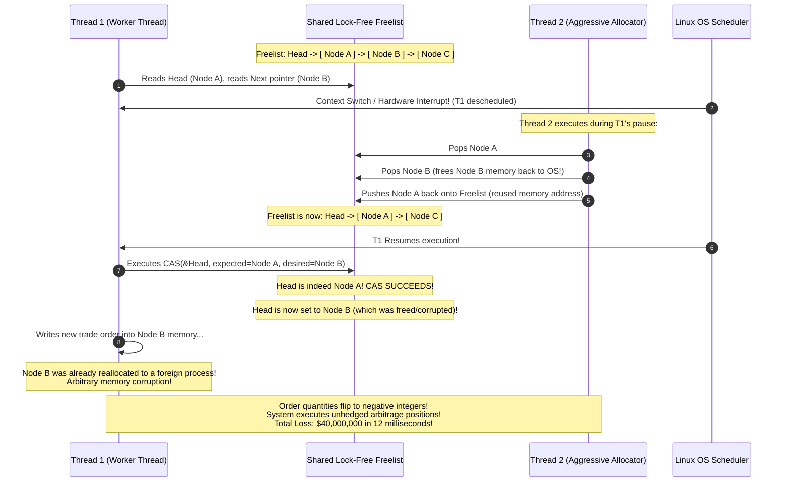

# Lock-Free Algorithms, Memory Models, and Safe Memory Reclamation

In ultra-low latency systems, high-frequency trading (HFT) platforms, kernel network stacks, and planetary-scale storage engines, traditional OS-level synchronization primitives (mutexes, conditional variables, semaphores) introduce intolerable latencies. Context switching a blocked thread to the kernel takes microseconds; priority inversion, lock contention, and convoying can freeze entire multi-core architectures.

**Lock-free programming** bypasses the operating system kernel entirely, coordinating concurrent threads directly through CPU hardware atomic primitives (such as Compare-And-Swap) and explicit memory ordering semantics. However, writing lock-free code is notoriously difficult: subtle hardware reorderings, the catastrophic ABA problem, and the nightmare of freeing memory while concurrent threads are still reading it (Safe Memory Reclamation) make it one of the most demanding disciplines in distributed systems and systems architecture.

Related Hands-On Runnable Lab:
* [`29_michael_scott_lock_free_queue/`](file:///home/prasanta/Documents/learning_folder/system_design/12_HANDS_ON_RUNNABLE_LABS/29_michael_scott_lock_free_queue/)

---

## 💡 Intuitive Real-World Physical Analogies

### 1. The Bank Line with Helping Hands (Michael-Scott Queue)
Imagine a bank with a single customer line marked by velvet ropes.
* **The Traditional Mutex Way:** Every time a new person enters or leaves the line, an armed guard locks the entire bank front door. Nobody can move an inch until the guard inspects every single person and unlocks the door. If the guard faints or sneezes, the whole bank freezes.
* **The Lock-Free MS-Queue Way:** The bank door stays wide open. 
  * Customers manage the rope themselves using atomic clips. 
  * If Customer Bob tries to clip his ticket to the end of the rope and notices that Customer Alice dropped her clip halfway through, Bob doesn't stop or wait. Bob **helps** Alice by clicking her clip onto the post for her, and then clicks his own ticket in place. The line flows continuously without a single lock.

### 2. The Restaurant Table Reservation Card (Hazard Pointers)
Imagine a busy restaurant where bussers clean tables and throw away old plates.
* A diner (Thread 1) is reading a menu at Table A.
* The head waiter (Thread 2) decides Table A's menu is outdated and removes Table A from the dining room directory.
* The busser wants to throw Table A into the dumpster (`free()`).
* **The Hazard Pointer:** Before reading the menu, the diner places a bright yellow sticky note on their chest saying: *"I am currently reading Table A"*.
* The busser checks all diners. If anyone has a sticky note pointing to Table A, the busser **defers** destruction. Only when all diners remove their sticky notes does Table A get thrown away.

### 3. The Museum Cleaning Shift (Epoch-Based Reclamation)
Imagine an art museum with three galleries:
* Visitors enter during **Epoch 1** and view paintings.
* The curator decides to retire a painting in Epoch 1. Instead of immediately burning it while people might still be looking at it, the curator sets it aside in a holding room stamped with `"Epoch 1"`.
* The museum advances the clock to **Epoch 2**, then **Epoch 3**.
* Because visitors only stay for at most one epoch, by the time the museum enters Epoch 3, the curator knows with $100\%$ certainty that every visitor who entered during Epoch 1 has left the museum. The Epoch 1 holding room can now be safely incinerated in one fast batch.

### 4. The Suitcase Baggage Claim Ticket (ABA Problem & Tagged Pointers)
* You check a black suitcase at an airport. You note its location: *"Carousel 4, Spot A"*.
* You look away for 10 seconds.
* A thief steals your black suitcase from Spot A, takes it to their car, dumps the clothes, and puts an identical-looking empty black suitcase back onto Spot A.
* You look back at Spot A. The suitcase looks identical! You pick it up thinking nothing changed—**disaster!**
* **The Tagged Pointer Solution:** The airline stamps every bag with a unique serial number that increments every time a bag touches the carousel: `(Spot A, Version 1)`. When the imposter puts the bag back, the badge reads `(Spot A, Version 2)`. You immediately know someone tampered with it!

---

## 👶 Plain-English / ELI5 Overview

When multiple CPU cores work on the same memory simultaneously, they need to stay synchronized:
* **The Old Way (Mutex Locks):** "Stop! Core 1 is using this variable. Cores 2, 3, and 4 must pause and wait until Core 1 is done." If Core 1 gets paused by the operating system, all other cores freeze.
* **The Lock-Free Way:** Nobody ever stops or waits. Cores use special hardware instructions built into CPU chips called **Compare-And-Swap (CAS)**. 
  * A core says: *"I think this variable is currently 5. If it is indeed 5, change it to 6. If someone else changed it while I was thinking, don't change anything and tell me it failed."*
  * If it fails, the core simply tries again. System-wide, at least one CPU core is *always* completing real work on every cycle.

### The Two Huge Dangers of Lock-Free Code:
1. **The ABA Problem:** A variable changes from `A` to `B`, and then back to `A`. If a thread checks only the value, it thinks nothing happened, even though the entire underlying data structure might have been destroyed and rebuilt.
2. **The Memory Freeing Hazard:** In C, C++, or Rust, if Thread 1 is reading a node and Thread 2 unlinks that node and calls `free(node)`, Thread 1 will read garbage memory and crash with a **Segmentation Fault (Use-After-Free)**. Lock-free systems require special algorithms (**Hazard Pointers** or **Epochs**) to know when it is actually safe to delete old memory.

---

## ⚠️ The Horror Scenario: The $40M HFT Freelist Corruption

A premier high-frequency trading firm deployed a new lock-free order-matching engine in C++20. To eliminate memory allocation latency, they implemented a lock-free memory pool (Freelist Stack) using raw atomic pointers with CAS:



### Why Did This Happen?
1. **The Classic ABA Vulnerability:** Thread 1 saw that `Head` was still `Node A`. It had no idea that `Node B` had been completely dequeued, destroyed, and deallocated while it was asleep.
2. **Absence of Generation Versioning:** The pointer was raw ($64\text{ bits}$) without an atomic version generation counter.
3. **No Safe Memory Reclamation:** The memory for `Node B` was returned to the allocator while Thread 1 still held a dangling register pointer to it.

---

## 1. The Non-Blocking Progress Hierarchy

In concurrent computing, synchronization is categorized by the mathematical progress guarantees provided across threads:

```
+---------------------------------------------------------------------------------+
|                        NON-BLOCKING PROGRESS HIERARCHY                          |
|                                                                                 |
|  [ Blocking Synchronization ]                                                   |
|    - Mutexes, Semaphores, Spinlocks                                             |
|    - Thread failure or preemption inside critical section blocks all peers      |
|                                                                                 |
|  [ Obstruction-Free ]                                                           |
|    - A thread guarantees progress if all other threads are suspended           |
|                                                                                 |
|  [ Lock-Free ]                                                                  |
|    - System-wide throughput is guaranteed: AT LEAST ONE thread makes progress   |
|      in a finite number of steps, even if individual threads starve             |
|                                                                                 |
|  [ Wait-Free ]                                                                  |
|    - EVERY thread guarantees progress in a bounded number of execution steps,  |
|      irrespective of the actions or speeds of concurrent peers (no starvation)  |
+---------------------------------------------------------------------------------+
```

### Mathematical Definitions:
* **Blocking:** A system where a paused or crashed thread holding a lock indefinitely blocks all other threads attempting to acquire the lock.
* **Obstruction-Free:** An isolated thread running without contention will complete in a bounded number of steps. Contention can cause livelock.
* **Lock-Free:** Infinitely many system-wide operations complete in finite time:
$$\forall t > 0, \; \exists \text{ thread } T_i \text{ that finishes an operation in finite steps}$$
* **Wait-Free:** Every individual thread completes its operation in a bounded number of steps $O(k)$ regardless of other thread delays:
$$\forall \text{ thread } T_i, \; \text{Steps}(T_i) \le K < \infty$$

---

## 2. Hardware Atomic Primitives and CPU Memory Models

Lock-free algorithms rely directly on CPU hardware atomic instructions rather than OS kernel context switches.

### 2.1 Hardware Atomics
1. **Compare-And-Swap (CAS):**
   ```c
   bool compare_and_swap(uint64_t* ptr, uint64_t expected, uint64_t desired) {
       // Atomic hardware execution (e.g., x86 'lock cmpxchg')
       if (*ptr == expected) {
           *ptr = desired;
           return true;
       }
       return false;
   }
   ```
2. **Fetch-And-Add (FAA):** Atomically increments a memory counter and returns the prior value (`lock xadd` on x86). Ideal for ticket locks and high-throughput counters.
3. **Load-Linked / Store-Conditional (LL/SC):** Used on ARM and RISC-V. `Load-Linked` (`ldrex`) monitors a memory address; `Store-Conditional` (`strex`) succeeds only if that cacheline has not been written to by any core in the interim. Naturally immune to ABA at the hardware level!

### 2.2 CPU Caches & The MESI Protocol
Multi-core processors maintain private L1/L2 caches and coordinate memory state via the **MESI (Modified, Exclusive, Shared, Invalid)** protocol:
* **False Sharing:** When two independent variables used by different cores reside on the same 64-byte cacheline. When Core 1 writes to Variable A, it invalidates the entire cacheline on Core 2, forcing Core 2 to reload Variable B from slow L3 cache or RAM.
* **Cacheline Bouncing:** High contention on a single atomic variable causes the cacheline to bounce back and forth between core caches over the interconnect bus, degrading performance below that of a mutex!

### 2.3 Memory Ordering Models
Modern out-of-order execution CPUs (x86, ARM, Apple Silicon) and optimizing compilers aggressively reorder instructions. Lock-free code requires explicit **Memory Fences**:

```
+-------------------------------------------------------------------------------+
|                             C++20 MEMORY ORDERS                               |
|                                                                               |
|  memory_order_relaxed:   Atomicity only. No synchronization or ordering.     |
|                                                                               |
|  memory_order_release:   Stores cannot be reordered AFTER this point.         |
|                          (Publishes data written prior to the release store)  |
|                                                                               |
|  memory_order_acquire:   Loads cannot be reordered BEFORE this point.         |
|                          (Consumes published data paired with release store)  |
|                                                                               |
|  memory_order_seq_cst:   Total global sequential consistency.                 |
|                          All threads observe exact same instruction order.    |
|                          (Flushes store buffers; highest CPU penalty)         |
+-------------------------------------------------------------------------------+
```

---

## 3. The ABA Problem and Pointer Versioning

The **ABA Problem** is the primary hazard when implementing lock-free data structures using raw CAS.

```
+-------------------------------------------------------------------------------+
|                            THE ABA HAZARD SCENARIO                            |
|                                                                               |
|  Initial Stack: Head -> [ Node A ] -> [ Node B ] -> [ Node C ]                |
|                                                                               |
|  Thread 1 (Pops):                                                             |
|  1. Reads Head = Node A                                                       |
|  2. Reads Next = Node B                                                       |
|  3. [Thread 1 Preempted before CAS]                                           |
|                                                                               |
|  Thread 2 (Interrupts):                                                       |
|  1. Pops Node A                                                               |
|  2. Pops Node B (deletes Node B from memory!)                                 |
|  3. Reallocates Node A and pushes it back onto Stack:                         |
|     Head -> [ Node A ] -> [ Node C ]                                          |
|                                                                               |
|  Thread 1 (Resumes):                                                          |
|  4. Executes CAS(&Head, expected=Node A, desired=Node B):                     |
|     Head still points to Node A! CAS SUCCEEDS!                                |
|  5. Result: Head now points to freed/corrupted Node B! Heap corruption!       |
+-------------------------------------------------------------------------------+
```

### Countermeasures: Tagged Pointers & Double-Word CAS
Store a monotonically increasing generation counter alongside the pointer:
$$\text{TaggedPointer} = \langle \text{Pointer } (64\text{ bits}) \;\parallel\; \text{GenerationCounter } (64\text{ bits}) \rangle$$
* On x86-64, this is verified atomically via `CMPXCHG16B` (128-bit CAS).
* On ARM64, this is executed via `CASP` (Compare and Swap Pair).
* If Node A is popped and repushed, its generation counter will have incremented: $\langle A, 1 \rangle \ne \langle A, 2 \rangle$, causing Thread 1's CAS to fail gracefully.

---

## 4. Safe Memory Reclamation (SMR)

In unmanaged languages (C, C++, Rust), a thread cannot call `free()` on an unlinked lock-free node immediately because concurrent threads may still be reading its contents.

```
+-------------------------------------------------------------------------------+
|                       SAFE MEMORY RECLAMATION TECHNIQUES                      |
|                                                                               |
| 1. Hazard Pointers (Maged Michael, 2004):                                     |
|    - Reader records node pointer in thread-local 'Hazard Array' before access.|
|    - Deleting thread buffers retired nodes; scans all active hazard pointers. |
|    - A node is only freed when no reader holds a hazard pointer to it.        |
|                                                                               |
| 2. Epoch-Based Reclamation (EBR):                                             |
|    - Global counter tracks epochs: e.g., Epoch 0, 1, 2.                       |
|    - Threads register active epoch on entering critical read section.         |
|    - Deleted nodes placed in retirement list of Epoch E.                      |
|    - When all threads have transitioned to Epoch >= E + 2, batch-free memory. |
|    - Extremely fast (amortized zero overhead per read).                       |
|                                                                               |
| 3. Read-Copy-Update (RCU):                                                    |
|    - Linux kernel standard for read-mostly tables (e.g., IP routing).         |
|    - Writers allocate a copy, apply mutations, atomic pointer swap.          |
|    - synchronize_rcu() waits for all existing readers to pass a context       |
|      switch (quiescent state) before freeing the old copy.                    |
+-------------------------------------------------------------------------------+
```

### Detailed Mechanics of Epoch-Based Reclamation (EBR):
1. **Global Epoch Counter:** A shared global epoch $E_{\text{global}} \in \{0, 1, 2\}$.
2. **Entering Critical Section:** A reader thread loads $E_{\text{global}}$ and records it in its local slot: $\text{ActiveEpoch}[i] = E_{\text{global}}$.
3. **Retirement:** When a writer unlinks a node, it places the node into $\text{RetiredList}[E_{\text{global}}]$.
4. **Advancing Epoch:** A background thread checks if all active threads have caught up to $E_{\text{global}}$. If yes, it advances $E_{\text{global}} = (E_{\text{global}} + 1) \pmod 3$.
5. **Reclamation:** Memory in $\text{RetiredList}[(E_{\text{global}} + 2) \pmod 3]$ can now be safely freed with $100\%$ mathematical certainty because no active thread can possibly hold a pointer from 2 epochs ago.

---

## 5. Case Study: Michael-Scott Lock-Free Queue (PODC 1996)

The **Michael-Scott Queue (MS-Queue)** is the canonical lock-free FIFO queue implemented in Java's `java.util.concurrent.ConcurrentLinkedQueue`.

### Queue Structure:
* Maintains a dummy **Sentinel Node** so that `Head` and `Tail` are never null.
* `Head` always points to the sentinel node (or the node just dequeued).
* `Tail` points to the last node (or trails by at most one node).

```
  Head                               Tail
   |                                  |
   v                                  v
+-------------+      +-------------+ +-------------+
|  Sentinel   | ---> |   Node 1    | |   Node 2    | ---> NULL
| Value: NULL |      |  Value: 42  | |  Value: 99  |
+-------------+      +-------------+ +-------------+
```

### The Helping Enqueue Algorithm
To ensure lock-freedom, if a thread detects that `Tail` is lagging, it **helps** advance `Tail` before retrying its own insertion:
```python
def enqueue(value):
    node = Node(value, next=None)
    while True:
        tail = self.tail
        next_node = tail.next
        if tail == self.tail:                   # Consistency check
            if next_node is None:
                # Tail is pointing to last node; try to link new node
                if CAS(tail.next, None, node):
                    # Step 2: Try to advance Tail pointer to new node
                    CAS(self.tail, tail, node)
                    return
            else:
                # Tail is lagging behind; help advance it
                CAS(self.tail, tail, next_node)
```

### The Dequeue Algorithm
```python
def dequeue():
    while True:
        head = self.head
        tail = self.tail
        first = head.next
        if head == self.head:                   # Consistency check
            if head == tail:
                if first is None:
                    return None                 # Queue is empty
                # Tail is lagging behind; help advance it
                CAS(self.tail, tail, first)
            else:
                # Read value before CAS to avoid use-after-free
                value = first.value
                if CAS(self.head, head, first): # Move sentinel forward
                    return value
```

---

## 6. High-Throughput Alternative: LMAX Disruptor

While linked lock-free queues require frequent allocations and pointer-chasing, the **LMAX Disruptor** utilizes a pre-allocated circular ring buffer designed for mechanical sympathy:

```
+-----------------------------------------------------------------------------+
|                          LMAX DISRUPTOR RING BUFFER                         |
|                                                                             |
|      Producer Sequence: [ 1042 ]             Consumer Sequence: [ 1038 ]    |
|                          |                                   |              |
|                          v                                   v              |
|                   [ Slot 0 | Slot 1 | Slot 2 | ... | Slot 1023 ]             |
|                                                                             |
| Design Optimizations:                                                       |
| 1. Pre-allocated memory: Zero runtime garbage collection / heap allocation |
| 2. Cacheline Padding: Prevents CPU cacheline bouncing (False Sharing)       |
| 3. Power-of-2 Ring: Fast bitwise modulo (sequence & (capacity - 1))         |
| 4. Memory Barriers: volatile sequence writes instead of costly CAS locks   |
+-----------------------------------------------------------------------------+
```

### Cacheline Padding in Practice:
```java
public class ValuePadding {
    protected long p1, p2, p3, p4, p5, p6, p7; // 56 bytes padding
    protected volatile long value = 0L;         // 8 bytes value
    protected long p9, p10, p11, p12, p13, p14; // 48 bytes padding
}
```
* Ensures that `value` sits on its own isolated 64-byte CPU cacheline. Concurrent writes to neighboring variables will never invalidate this core's cache!

---

## 7. Comparison: Mutexes vs Lock-Free vs Wait-Free

| Dimension | Mutex (Pthreads / OS) | Lock-Free (MS-Queue / CAS) | Wait-Free (Universal Const.) |
| :--- | :--- | :--- | :--- |
| **Throughput (Low Contention)** | High (Fast futex path) | Very High | High |
| **Throughput (High Contention)**| Collapses (Thread descheduling)| Remains High | Remains Predictable |
| **Latency Bounds** | Unbounded (Priority inversion) | Unbounded for individual thread | Strictly Bounded $O(N)$ steps |
| **Preemption Resilience** | Poor (Blocks all waiters) | Immune to thread pauses | Immune to thread pauses |
| **Implementation Complexity** | Low | High (ABA, SMR, Memory Fences)| Very High |
| **Memory Reclamation** | Trivially handled by scope | Requires Hazard Ptr / EBR | Requires Hazard Ptr / EBR |
| **False Sharing Risk** | Low (Internal to OS mutex) | Critical (Requires cacheline pad)| Critical |

---

## 8. Real-World Production Battle-Testing

### 1. Linux Kernel RCU (Read-Copy-Update)
* Powers core Linux kernel subsystems including the IP routing table, VFS directory cache, and network socket tables.
* Billions of network packets traverse routing tables without acquiring a single lock or executing a single atomic instruction on read paths.
* Writers make a clone, mutate the clone, atomically swap the pointer, and invoke `call_rcu()` to asynchronously free the old table after a CPU grace period.

### 2. Java `java.util.concurrent`
* `ConcurrentLinkedQueue` is a direct industrial implementation of the Michael-Scott queue.
* `LongAdder` splits a high-contention counter into an array of cell counters, allowing threads to update distinct cachelines via hash offsets, eliminating atomic bus saturation.

### 3. LMAX Financial Exchange
* Processes **6,000,000 orders per second** on a single thread running over a Disruptor ring buffer.
* Eliminates inter-thread lock contention entirely, achieving deterministic $p99.99$ latencies under $15\text{ microseconds}$.

---

## 9. Practical Trade-Offs & Rules of Thumb

### When to Use Lock-Free Algorithms
1. **Ultra-Low Latency Pipelines ($p99 < 10\mu s$):** In financial matching engines, audio DSP pipelines, and network packet routers where thread descheduling cannot be tolerated.
2. **Interrupt Handlers & Signal Handlers:** An OS signal handler cannot acquire a mutex held by the interrupted thread without deadlocking itself. Lock-free ring buffers are mandatory.
3. **Multi-Core Asymmetric Speeds:** When worker threads run at widely different execution speeds, lock-free structures guarantee that slow threads never stall fast peers.

### When NOT to Use Lock-Free
1. **Extreme Core Contention on a Single Address:** If 64 CPU cores simultaneously execute CAS in a tight loop on a single pointer, the CPU bus saturates with cacheline invalidate messages. A standard spinlock with exponential backoff or ticket lock will actually outperform raw CAS!
2. **Complex Multi-Object Mutations:** CAS can atomically update only 8 or 16 contiguous bytes. Coordinating mutations across 3 separate objects lock-free requires complex multi-word CAS (MWCAS) or Software Transactional Memory (STM). Use a fine-grained mutex instead.
3. **Managed Runtimes with Low Contention:** If you are building standard enterprise microservices in Go or Java, native mutexes (`sync.Mutex` or `ReentrantLock`) are heavily optimized via adaptive spinning and futexes, and are vastly simpler to maintain safely.

---

## 🎯 Top Real-World Interview Questions & Deep-Dive Answers (FAANG / Staff Level)

### Q1: "Explain the ABA problem in lock-free data structures. How do you solve it in a production C++20 environment without garbage collection?"

#### The Interviewer's Trap
Candidates often say: *"Just add a counter to the node."* But if the counter is inside the allocated node itself, reading the counter after the node has been deallocated causes a segmentation fault! The counter MUST be packaged into the *pointer itself* or tracked externally.

#### Staff-Level Architecture Solution
* **Root Cause:** CAS checks only memory bit identity ($\text{value} == \text{expected}$), not semantic history. If pointer $A$ is freed, reallocated by another thread, and pushed back, the pointer bits are identical, but the node's internal state and child pointers are completely altered.
* **Production Solution in C++20:**
  1. **Double-Word Compare-And-Swap (DWCAS / Tagged Pointer):**
     Package a 64-bit pointer and a 64-bit monotonic sequence counter into a 128-bit struct:
     ```cpp
     struct alignas(16) TaggedPointer {
         Node* ptr;
         uint64_t tag;
     };
     std::atomic<TaggedPointer> head;
     ```
     On x86-64, this compiles to the hardware atomic instruction `lock cmpxchg16b`. Every time `head` is updated, `tag` increments. Even if the node pointer address is recycled, the tag will differ, causing the CAS to fail safely.
  2. **Safe Memory Reclamation Pairing:** DWCAS solves the ABA problem, but does not solve the Use-After-Free problem. You must pair DWCAS with **Hazard Pointers** or **Epoch-Based Reclamation (EBR)** to ensure no thread deallocates `Node` memory while another thread's registers hold references to it.

---

### Q2: "Compare Hazard Pointers against Epoch-Based Reclamation (EBR). Which one would you choose for an ultra-low-latency in-memory cache, and why?"

#### The Interviewer's Trap
Claiming that Hazard Pointers are always superior because they free memory sooner. In ultra-low latency read paths, Hazard Pointers impose significant overhead because readers must execute atomic store-load memory barriers (`mfence` or `seq_cst`) to publish their hazard pointer before dereferencing a node.

#### Staff-Level Architecture Solution
* **Architectural Comparison:**
  | Metric | Hazard Pointers | Epoch-Based Reclamation (EBR) |
  | :--- | :--- | :--- |
  | **Read Path Overhead** | High (Requires atomic store + memory barrier per read) | **Virtually Zero** (Single non-atomic or relaxed read of global epoch) |
  | **Memory Reclamation Boundedness**| **Strictly Bounded** ($O(N_{\text{threads}} \cdot K)$ nodes in flight) | **Unbounded if a thread stalls** (Stalled thread delays epoch advancement) |
  | **Implementation Complexity** | High (Thread registration, dynamic hazard arrays) | Moderate (3-epoch circular buffer) |
* **Decision for Ultra-Low-Latency Cache:**
  - Choose **Epoch-Based Reclamation (EBR)**.
  - *Justification:* In an in-memory cache, read operations dominate ($95\%+$ reads). EBR readers pay almost zero cost: they simply read a relaxed global epoch integer into a thread-local variable upon entering the critical section. There are no expensive CPU store-buffer flushes or bus locks.
  - *Mitigating EBR's weakness:* To prevent a stalled thread from holding back epoch garbage collection forever, production systems (like Crossbeam in Rust) implement **Quiescent Heartbeats**: if a worker thread pauses for more than $50\text{ ms}$, it is evicted from the active reader mask, allowing memory reclamation to proceed.

---

### Q3: "What is False Sharing, how does it degrade multi-threaded performance, and how do you design cache-friendly concurrent data structures to eliminate it?"

#### The Interviewer's Trap
Confusing False Sharing with race conditions or logical locking bugs. False Sharing is a pure hardware cache-coherency phenomenon that occurs even when code is mathematically thread-safe!

#### Staff-Level Architecture Solution
* **Physical Mechanics:**
  Modern CPUs transfer data between L3 cache and L1/L2 core caches in fixed **64-byte Cachelines**.
  If Thread A on Core 0 writes to `struct.varA` and Thread B on Core 1 writes to `struct.varB`, and both variables sit within the same 64-byte memory slice:
  1. Core 0 writes to `varA`, transitioning the cacheline in Core 0's L1 cache to `Modified (M)`.
  2. The MESI protocol sends an `Invalidate` broadcast across the CPU bus to all other cores.
  3. Core 1's cacheline holding `varB` is marked `Invalid (I)`.
  4. When Core 1 attempts to write to `varB`, it experiences an L1 cache miss, forcing an expensive fetch from L3 or memory bus.
  5. The cacheline ping-pongs violently between the two cores (**Cacheline Bouncing**), collapsing multi-core throughput by $10\times$ to $50\times$.
* **Architectural Solutions:**
  1. **Explicit Cacheline Padding / Alignment:**
     Force hot concurrent variables to sit on independent 64-byte boundaries:
     ```cpp
     struct alignas(64) WorkerState {
         std::atomic<uint64_t> counter;
         char padding[64 - sizeof(std::atomic<uint64_t>)]; // Explicit pad
     };
     ```
  2. **Thread-Local Striping (`LongAdder` Pattern):**
     Instead of having all threads update a single shared counter, allocate an array of $N$ padded counters indexed by `hash(thread_id) % N`. Reads sum across all cells. This eliminates all inter-core cache invalidation traffic during write-heavy bursts.

---

### Q4: "Under what specific conditions will a lock-free queue perform WORSE than a standard mutex or spinlock, and how does the LMAX Disruptor or Flat Combining pattern solve this?"

#### The Interviewer's Trap
Believing that lock-free is universally faster than locking. Under heavy multi-producer contention, lock-free queues degrade dramatically.

#### Staff-Level Architecture Solution
* **Why Lock-Free Queues Collapse Under High Contention:**
  In a Michael-Scott queue, every enqueue requires executing a CAS on `Tail.next`. If 32 threads attempt to enqueue simultaneously:
  1. Exactly 1 thread succeeds; the other 31 threads fail their CAS.
  2. The 31 failed threads loop and retry immediately.
  3. This generates 31 concurrent atomic memory instructions saturating the CPU interconnect bus with MESI invalidation traffic.
  4. Threads waste CPU cycles spinning in retry loops without making progress, while a standard OS mutex puts contending threads to sleep via `futex`, freeing CPU execution units for other workloads.
* **Architectural Solutions:**
  1. **The LMAX Disruptor:**
     Replaces dynamic node pointer CAS with a pre-allocated circular ring buffer. A single producer assigns sequence slots using relaxed increments, or uses memory barriers without dynamic pointer swinging, avoiding memory allocation and cache invalidations entirely.
  2. **Flat Combining (Hendler et al.):**
     Instead of 32 threads fighting over the queue tail, contending threads write their operations into thread-local publication slots. One single thread acquires a global lock, becomes the **Combiner**, scans all publication slots, executes all enqueues in a single tight, vectorized batch using pure sequential memory access, and publishes the results. Contention is turned into cache-friendly sequential batching, often delivering $5\times$ higher throughput than lock-free CAS queues under high contention.
