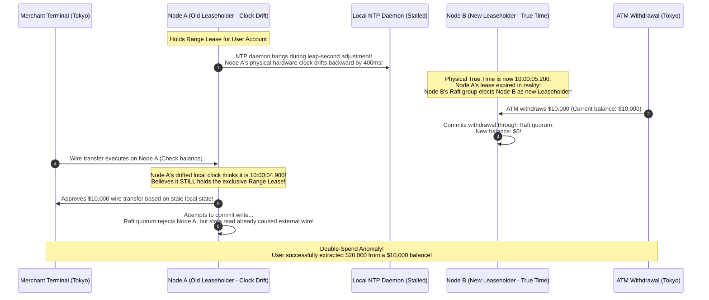
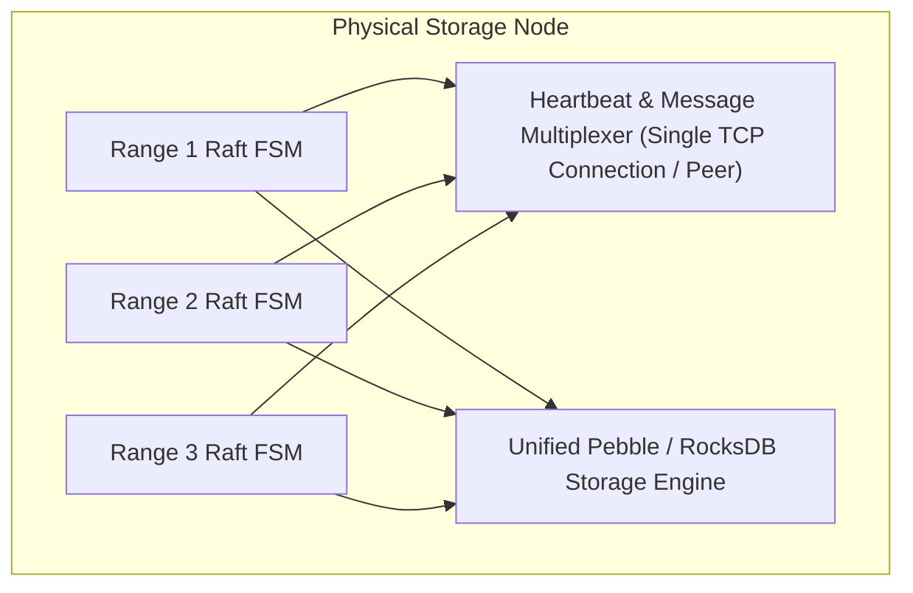

# Multi-Raft Consensus, Dynamic Range Splitting, and Range Leases

Classic consensus protocols like Paxos and Raft are the foundational building blocks of reliable distributed systems. However, standard Raft operates as a **single consensus group**. While single-group consensus is ideal for metadata coordination services (such as etcd or ZooKeeper) storing tens of gigabytes of cluster configurations, it hits a hard mathematical and physical ceiling when applied to planetary-scale databases handling petabytes of data and millions of transactions per second.

Modern distributed NewSQL databases—including **Google Spanner, CockroachDB, and PingCAP TiKV**—break through this scalability ceiling by implementing **Multi-Raft**, dynamically partitioning the keyspace into hundreds of thousands of independent mini-Raft groups, and introducing **Range Leases** to deliver linearizable ACID reads at local NVMe disk speed with zero network round-trips.

Related Hands-On Runnable Labs:
* [`06_raft_leader_election/`](file:///home/prasanta/Documents/learning_folder/system_design/12_HANDS_ON_RUNNABLE_LABS/06_raft_leader_election/)
* [`11_distributed_lock_fencing/`](file:///home/prasanta/Documents/learning_folder/system_design/12_HANDS_ON_RUNNABLE_LABS/11_distributed_lock_fencing/)

---

## 💡 Intuitive Real-World Physical Analogies

### 1. The Municipal District City Councils vs. A Single King (Multi-Raft)
* **Single-Group Raft (The King):** Imagine an entire nation of $100\text{ million}$ citizens where every single decision—from approving a building permit in a remote village to declaring war—must be personally reviewed and voted on by the King and his 5 royal advisors in the capital. The royal council becomes an impossible bottleneck, and the kingdom grinds to a halt.
* **Multi-Raft (Local City Councils):** The nation is divided into 10,000 independent municipal districts (Ranges). 
  * District 1 (Keys `["a" - "b")`) has its own 3-person council.
  * District 2 (Keys `["b" - "c")`) has its own distinct 3-person council.
  * A pothole repair in District 1 never involves District 2. 10,000 councils vote concurrently on independent matters across the country, scaling decision throughput linearly.

### 2. The Overstuffed High School Yearbook (Dynamic Range Splitting)
Imagine compiling a school yearbook.
* You start with a single binder labeled `Students: A - Z`.
* As the school grows, the binder reaches 500 pages and becomes too heavy to lift (a Range hitting its 64 MB limit).
* The librarian doesn't throw away the binder or recopy all pages. 
* She takes a pair of scissors, opens the binder right at the letter `M`, splits the binder into two smaller binders—`Binder 1: [A - M)` and `Binder 2: [M - Z)`—and puts both back on the shelf. The operation takes 1 second, and no existing pages are rewritten.

### 3. The Apartment Building Master Key Lease (Range Leases)
* In standard Raft, before the building superintendent lets a tenant read the building rules, the super must knock on the doors of a majority of all co-op board members to ask: *"Am I still the superintendent today?"* This quorum check takes valuable time on every single read.
* **The Range Lease Solution:** The co-op board signs an official lease granting the superintendent exclusive operational authority from **9:00 AM to 9:05 AM**.
* During those 5 minutes, whenever a tenant asks to read a document, the superintendent answers **immediately** from memory without making a single phone call or knocking on any doors. The superintendent knows with $100\%$ legal certainty that no one else can usurp authority until 9:05 AM.

---

## 👶 Plain-English / ELI5 Overview

When you build a database with standard Raft (like etcd):
1. **There is only one leader:** Every single write must travel through one machine's CPU and disk.
2. **Every machine holds all data:** If your database has 10 Terabytes of data, every single server must buy a 10 Terabyte SSD. You cannot scale out simply by buying more computers.
3. **Reads are surprisingly slow:** To guarantee you don't read stale data from a leader that got disconnected, the leader must ping a majority of its followers before answering *every single read request*.

**How Modern Databases (CockroachDB, TiKV) Fix This:**
* **Multi-Raft:** They slice the database keys into small sorted chunks called **Ranges** (typically 64 MB each). If you have 1 Terabyte of data, you have 16,000 independent Ranges. Each Range has its own 3-node Raft consensus group. Node 1 can be the leader for Range A, while Node 2 is the leader for Range B.
* **Dynamic Range Splitting:** When a Range grows larger than 64 MB, it splits in half into two 32 MB Ranges automatically, without locking the database or moving files.
* **Range Leases:** Followers give the leader a time-bounded "lease" (e.g., valid for 9 seconds). As long as the lease is valid, the leader serves read requests directly from its local disk in **0 milliseconds** without asking followers for permission.

---

## ⚠️ The Horror Scenario: The Clock-Drift Phantom Overwrite

A multi-region fintech bank deployed a distributed NewSQL cluster across New York, London, and Tokyo. The database relied on Range Leases for zero-RTT linearizable balance checks and transactions:



### Why Did This Disaster Occur?
1. **Unbounded Physical Clock Drift:** Node A relied on raw wall-clock time for lease expiration. When its clock drifted backwards by $400\text{ ms}$, it served reads during a window where Node B had already taken over the lease.
2. **Missing Monotonic Bound:** The lease implementation failed to enforce **Hybrid Logical Clocks (HLC)** with strict maximum clock offset enforcement ($\epsilon_{\max}$).
3. **Failure to Coordinate Lease Handover:** Node B assumed ownership before verifying that Node A's maximum possible physical time window had elapsed.

---

## 1. The Scalability Ceiling of Single-Group Raft

Standard Raft (Ongaro & Ousterhout, 2014) operates across a single cluster of $2F+1$ nodes. While optimal for coordination services (e.g., ZooKeeper, etcd) managing gigabytes of metadata, single-group consensus collapses under planetary database workloads:

1. **Throughput Bottleneck:** Every write must pass through a single Raft leader, bounding cluster throughput to the network and disk I/O of one machine ($\approx 10,000 - 50,000 \text{ writes/sec}$).
2. **Storage Limit:** Every node must store the entire state machine, capping maximum cluster capacity to a single server's disk ($\approx 10 - 20 \text{ TB}$).
3. **Cross-Region Latency:** Wide-area replication imposes cross-continent round-trip latencies ($\ge 100\text{ ms}$) on every operation because all quorums cross WAN boundaries.

---

## 2. Multi-Raft Architecture (TiKV, CockroachDB, Spanner)

**Multi-Raft** scales horizontal capacity linearly by partitioning the contiguous keyspace into millions of independent, localized consensus groups called **Ranges** (CockroachDB) or **Regions** (TiKV):

```
+-------------------------------------------------------------------------------+
|                            MULTI-RAFT ARCHITECTURE                            |
|                                                                               |
| Contiguous Keyspace:                                                          |
| [  Range 1: ["a" - "g")  ] [  Range 2: ["g" - "p")  ] [  Range 3: ["p" - "z") ]
|                                                                               |
| Physical Cluster:                                                             |
| +-------------------+  +-------------------+  +-------------------+           |
| | Node 1            |  | Node 2            |  | Node 3            |           |
| | [ Range 1: Leader]|  | [ Range 1: Follow]|  | [ Range 1: Follow]|           |
| | [ Range 2: Follow]|  | [ Range 2: Leader]|  | [ Range 2: Follow]|           |
| | [ Range 3: Follow]|  | [ Range 3: Follow]|  | [ Range 3: Leader]|           |
| +-------------------+  +-------------------+  +-------------------+           |
+-------------------------------------------------------------------------------+
```

### Managing Thousands of Raft Groups per Server:
* **Heartbeat Multiplexing:** Individual Raft groups do not send isolated TCP packets. Instead, background workers aggregate heartbeats across thousands of co-located ranges into single batched RPCs between physical nodes.
* **Shared Storage Engine:** All local replicas on a machine write their WAL logs and state machines to a unified RocksDB or Pebble engine using multi-column families or prefixed range keys:
$$\text{Storage Key} = \langle \text{RangeID } (64\text{ bits}) \parallel \text{UserKey} \parallel \text{Timestamp} \rangle$$



---

## 3. Dynamic Range Lifecycle: Splitting, Merging, and Balancing

Ranges are dynamically sized (typically 64 MB to 512 MB) to balance parallelism with metadata overhead.

### 3.1 Range Splitting
When a range exceeds its maximum configured size (e.g., 64 MB) or experiences extreme hotspot load:
1. The leader selects a median boundary split key $K_{\text{split}}$.
2. A special **Split Proposal** is appended to the Raft log of the existing range:
$$\text{Op: SplitRange}(\text{RangeID}=1, \; \text{NewRangeID}=2, \; \text{Boundary}=K_{\text{split}})$$
3. When the split log entry commits across the quorum:
   * The state machine atomically truncates Range 1 to $[K_{\text{start}}, K_{\text{split}})$.
   * Instantiates Range 2 with range $[K_{\text{split}}, K_{\text{end}})$.
   * Inherits the current replica membership without moving any data on disk!

```
                    BEFORE SPLIT:
                    [ Range 1: ["a" - "z") (Size: 120MB) ]
                                    |
                         (Split at key "m")
                                    v
                    AFTER SPLIT:
   [ Range 1: ["a" - "m") (60MB) ]   [ Range 2: ["m" - "z") (60MB) ]
```

### 3.2 Range Merging
When adjacent ranges shrink below threshold (e.g., after heavy row deletes), a distributed coordinator (e.g., TiKV Placement Driver or CockroachDB Allocator) merges them into a contiguous single range to reclaim metadata overhead.

### 3.3 Replica Rebalancing
To distribute data evenly across new storage nodes:
1. Replicas add a **Learner** (non-voting) member to the target node.
2. The leader streams a point-in-time storage snapshot (SST files) to the learner.
3. Once caught up with the WAL stream, the learner is promoted to a full voter via Raft Joint Consensus, and an over-provisioned node's replica is dropped.

---

## 4. The Read Optimization Problem & Range Leases

In vanilla Raft, linearizable reads require either:
1. Writing a dummy read entry into the Raft log (costly disk write), OR
2. Heartbeating a majority quorum before serving every read to verify the leader has not been deposed by a network partition (**ReadIndex** protocol, which incurs 1 network RTT).

### The Range Lease Solution (Zero-RTT Linearizable Reads)
A **Range Lease** grants an exclusive time-bounded lease to a single replica (the **Leaseholder**), guaranteeing that no other replica will execute conflicting mutations during the lease duration $[t_{\text{start}}, t_{\text{end}}]$.

```
+-------------------------------------------------------------------------------+
|                       RANGE LEASE READ/WRITE FLOW                             |
|                                                                               |
| Read Request:                                                                 |
| Client -----> Leaseholder -----> Read from local MVCC store (0 RTT Quorum!)   |
|                                                                               |
| Write Request:                                                                |
| Client -----> Leaseholder -----> Forward to Raft Leader -----> Quorum Replicas|
+-------------------------------------------------------------------------------+
```

### Invariants Maintained by Range Leases:
1. **Disjoint Leases:** At any point in physical time (or Hybrid Logical Time), at most one replica holds an active lease for range $R$.
2. **Lease Renewal via Raft:** The lease is itself acquired and renewed by committing a `RequestLease` command through the Raft consensus log.
3. **Safe Split Coordination:** A split cannot finalize until the leaseholder coordinates with the Raft group, preventing split-brain queries.
4. **Co-location:** In normal operation, the Raft Leader and the Leaseholder reside on the exact same physical node. A linearizable read requires **zero network round-trips to peers**, serving reads at local NVMe disk speed.

### Clock Drift Safeguards:
* **Epoch-Based Leases:** Instead of wall-clock durations, leases can be tied to Raft leader epochs and renewed continuously via heartbeats.
* **Max Clock Offset Enforcement:** If a node detects that its clock drift relative to peers exceeds $\epsilon_{\max}$ (e.g., $250\text{ ms}$ via NTP or HLC monitoring), the node **voluntarily crashes itself (suicide)** to prevent serving stale reads.

---

## 5. Architectural Deep Dive: TiKV vs CockroachDB vs Spanner

| Architecture Dimension | PingCAP TiKV | CockroachDB | Google Spanner |
| :--- | :--- | :--- | :--- |
| **Cluster Topology** | Decoupled Compute (TiDB) and Storage (TiKV) | Symmetrical SQL + Storage Nodes | Decoupled Spanner Compute & Colossus Storage |
| **Cluster Coordinator** | Centralized Placement Driver (PD) using etcd | Gossip Protocol + Multi-Level System Ranges | Paxos-based Location Service |
| **Consensus Protocol** | Multi-Raft (Rust) | Multi-Raft (Go) | Multi-Paxos (C++) |
| **Clock Synchronization** | Centralized Timestamp Oracle (TSO) | Hybrid Logical Clocks (HLC) + Max Offset Bound | **TrueTime API** (GPS Receivers + Atomic Clocks, $\epsilon \approx 7\text{ms}$) |
| **Read Consistency Primitive** | Raft ReadIndex or Follower Read | Epoch-based Range Leases + HLC MVCC | Leader Leases + TrueTime Commit Wait |
| **Storage Engine** | RocksDB / Titan (Separate KV & Raft engines) | Pebble (LSM engine optimized for Go) | Custom Append-Only LSM / Colossus File System |
| **Range Split Trigger** | Size (96MB default) or Keys Count | Size (64MB default) or CPU Hotspot | Load-based and Size-based |

---

## 6. Real-World Production Battle-Testing

### 1. CockroachDB in Tier-1 Financial Banking
* Powers mission-critical banking ledgers (e.g., Starling Bank, Comcast).
* Survives complete AWS / GCP availability zone destruction without data loss ($RPO = 0, RTO < 4\text{ seconds}$).
* Multi-Raft enables range locality: European user data ranges have their Raft replicas confined strictly to European regions to satisfy GDPR data residency mandates.

### 2. PingCAP TiKV / TiDB
* Deployed across hundreds of nodes in major e-commerce platforms (Shopee, Meituan) handling over $10\text{ million}$ QPS during flash sales.
* Dynamic range splitting automatically divides high-traffic product ranges across dozens of NVMe storage nodes in real time.

---

## 7. Practical Trade-Offs & Rules of Thumb

### Optimal Range Sizing
* **Too Small (e.g., 4 MB):** The cluster metadata explodes. Managing 10,000,000 ranges strains Raft heartbeat batching, increases memory usage for Raft state machines, and causes frequent splits.
* **Too Large (e.g., 4 GB):** Range splits take too long; rebalancing a replica to a new node requires transferring multi-gigabyte SST snapshots, saturating intra-cluster network bandwidth.
* **Rule of Thumb:** Use **64 MB to 256 MB** per Range. This provides the ideal sweet spot between sub-second split execution and manageable metadata cardinality.

### The Sequential Primary Key Disaster:
Never use auto-incrementing integer primary keys (`id SERIAL PRIMARY KEY`) in Multi-Raft NewSQL!
* All inserts with increasing numbers (`id=1001, 1002, 1003...`) hit the exact same single Range at the tail end of the keyspace.
* Result: A single machine does $100\%$ of the write work while 99 other nodes sit idle.
* **Solution:** Use UUIDv4, hash-prefixed keys, or multi-column primary keys where the first column is a tenant ID or shard identifier to distribute inserts evenly across all Multi-Raft groups.

---

## 🎯 Top Real-World Interview Questions & Deep-Dive Answers (FAANG / Staff Level)

### Q1: "Design a globally distributed horizontally scalable NewSQL database. How do you scale Raft consensus to support petabytes of data and millions of writes per second?"

#### The Interviewer's Trap
A candidate might try to scale a single Raft cluster by adding more nodes. But adding nodes to a single Raft cluster *decreases* write throughput because the leader must collect larger quorums!

#### Staff-Level Architecture Solution
1. **Multi-Raft Range Partitioning:**
   - Partition the global sorted keyspace into ranges of $64\text{ MB}$.
   - Assign each range to an independent 3-node or 5-node Raft consensus group.
   - Distribute range leaders evenly across physical servers. If a cluster has 100 nodes and 100,000 ranges, each node hosts approximately 1,000 range leaders and 2,000 range followers.
2. **Heartbeat Multiplexing:**
   - Eliminate individual Raft ticker goroutines/threads.
   - Aggregate all range messages destined for the same target server into a single pipelined TCP connection using batched Protobuf RPCs.
3. **Storage Engine Decoupling:**
   - Co-locate all local range replicas on a unified, high-performance LSM storage engine (Pebble/RocksDB). Keys are prefixed with `RangeID`.
4. **Horizontal Scaling:**
   - When new nodes join, background balancers migrate range replicas using Raft Joint Consensus, scaling storage and write IOPS linearly with node count.

---

### Q2: "How do Range Leases allow linearizable reads with zero network round-trips, and what prevents a deposed leader from serving stale data during a network partition?"

#### The Interviewer's Trap
Saying that "the leader just reads from its local disk because it's the leader." In vanilla Raft, a leader can be partitioned off into a minority network isolate while the majority has already elected a new leader. Reading locally from an isolated leader violates linearizability (**Stale Read Anomaly**).

#### Staff-Level Architecture Solution
* **How Range Leases Work:**
  1. The leader acquires an exclusive lease for time window $[T_1, T_2]$ by proposing a `MsgRequestLease` command through the Raft log.
  2. The command is committed only after receiving quorum approval from the majority.
  3. Invariants guarantee that **no other replica can be granted a lease that overlaps with $[T_1, T_2]$**.
  4. While local clock $T_{\text{now}} < T_2 - \epsilon_{\max}$, the leaseholder serves reads directly from its local MVCC disk without network communication.
* **Handling Network Partitions & Preventing Stale Reads:**
  - If the leaseholder is partitioned, it continues serving reads *only until its active lease expires at $T_2$*.
  - Meanwhile, the majority partition cannot elect a new leaseholder or commit new writes to that range until $T_2$ has elapsed in physical time!
  - Once $T_2$ passes, the majority partition grants a new lease to a new leaseholder. The partitioned old leader sees its lease has expired and immediately rejects client queries, guaranteeing strict linearizability across all partitions.

---

### Q3: "Explain the exact sequence of events when a 64 MB Range splits into two 32 MB Ranges. How is this accomplished atomically without moving data or stalling client transactions?"

#### The Interviewer's Trap
Believing that splitting a range requires copying half the data over the network to a new server.

#### Staff-Level Architecture Solution
```mermaid
sequenceDiagram
    autonumber
    participant Client as Application Client
    participant Leader as Range 1 Leader (Node 1)
    participant Quorum as Raft Replicas (Nodes 2 & 3)
    participant Storage as Local Pebble Engine

    Leader->>Leader: Detects Range 1 size = 68 MB > 64 MB threshold
    Leader->>Leader: Scans local SST index; finds median key K_split = "m"
    Leader->>Quorum: Proposes Raft Command: SplitRange(ID=1, NewID=2, SplitKey="m")
    Quorum-->>Leader: Quorum Ack (Committed)
    
    Note over Leader,Storage: State Machine Atomic Execution:
    Leader->>Storage: Updates Range 1 metadata: EndKey = "m"
    Leader->>Storage: Creates Range 2 metadata: StartKey = "m", EndKey = "z"
    Note over Leader,Storage: Both Range 1 and 2 share identical replica peer lists!<br/>Zero data bytes moved on disk!
    
    Leader->>Leader: Instantiates Range 2 Raft state machine in memory
    Leader->>Client: Acknowledges Split complete (Total duration: < 10ms)
```
1. **Median Selection:** The leader uses internal LSM index block samples to pick a split key $K_{\text{split}}$ that divides data exactly $50/50$.
2. **Consensus Coordination:** The leader commits a `SplitRange` proposal through the existing Range's Raft group.
3. **Atomic Boundary Update:** When the entry applies to the state machine, the range descriptor is updated in the local engine:
   - Old Range 1: $[\text{StartKey}, K_{\text{split}})$
   - New Range 2: $[K_{\text{split}}, \text{EndKey})$
4. **Zero-Copy Instant Split:** Because the underlying LSM-tree (RocksDB/Pebble) stores all keys in global sorted order, Range 1 and Range 2 simply point to their respective key boundaries within the *existing* local database files. Not a single row is rewritten or moved over the network!

---

### Q4: "Why do auto-incrementing sequential integer IDs degrade performance in a Multi-Raft NewSQL database, and what architectural strategies prevent this hotspot?"

#### The Interviewer's Trap
Suggesting that "increasing the number of Raft replicas" will solve the write bottleneck. Replicas only handle reads and consensus durability; adding replicas does not scale write capacity.

#### Staff-Level Architecture Solution
* **The Root Cause:**
  Multi-Raft partitions data into ranges based on contiguous key ranges:
  - Range 1: `[1 - 100,000)`
  - Range 2: `[100,000 - 200,000)`
  - Range 3: `[200,000 - 300,000)`
  If transactions use auto-incrementing IDs (`1001, 1002, 1003...`), **$100\%$ of all write traffic hits the single Range containing the maximum current ID**. The entire cluster's write capacity collapses to the speed of the single machine hosting that one range leader (**The Range Monopolization Hazard**).
* **Architectural Remedies:**
  1. **UUIDv4 / Random 128-bit Keys:**
     Spreads inserts uniformly across the entire keyspace and all 10,000 ranges simultaneously.
  2. **Hash-Sharded Indexes:**
     Compute a virtual shard bucket prefix:
     $$\text{Key} = \text{hash}(\text{ID}) \pmod{32} \parallel \text{ID}$$
     Distributes consecutive IDs across 32 separate Ranges uniformly.
  3. **Multi-Column Composite Keys:**
     Prefix the primary key with a natural partitioning tenant dimension (e.g., `(tenant_id, created_at, order_id)`). This ensures that while a single tenant's data is sequential, the global write load is dispersed across hundreds of tenant ranges.
