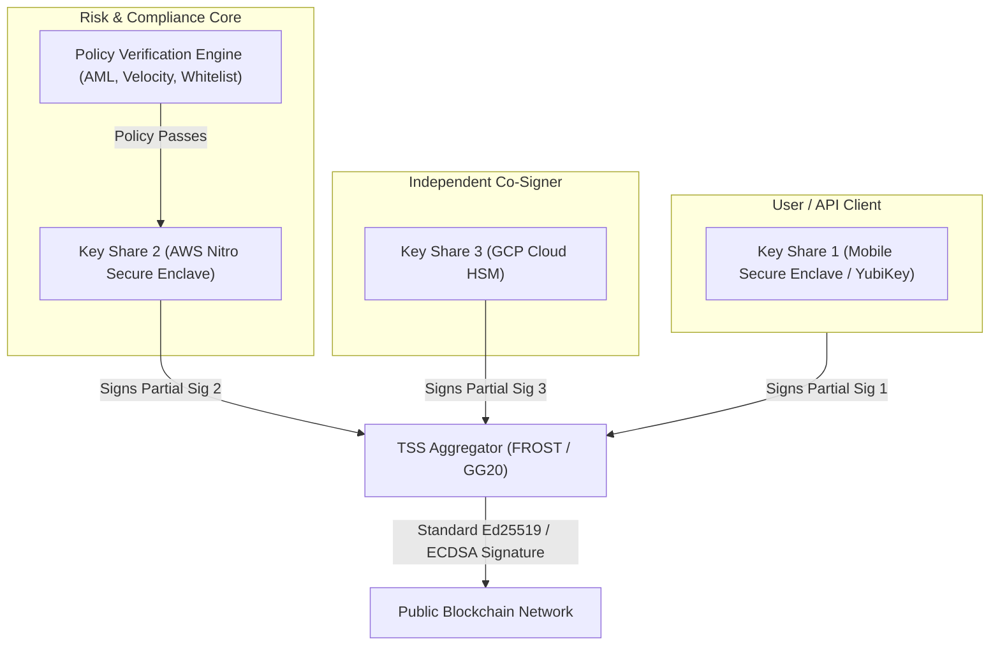

# Threshold Cryptography, Secure MPC, and Zero-Knowledge Proofs in Distributed Systems

In traditional enterprise security architectures, trust is centralized: master encryption keys, root certificate authorities (CAs), and financial treasury credentials reside on a single server, database column, or Hardware Security Module (HSM). If an attacker breaches that single machine, compromises a root administrator's credentials, or physically exfiltrates the HSM, the entire kingdom falls.

Modern distributed cryptography—spanning **Threshold Cryptography, Secure Multi-Party Computation (SMPC), and Zero-Knowledge Proofs (ZKPs)**—fundamentally redefines distributed trust. Instead of trusting a central authority, secrets are mathematically shattered across autonomous nodes such that **no single node ever possesses the master secret**, computations can be executed over encrypted data without decrypting it, and mathematical proofs can verify complex transactions without revealing a single byte of underlying sensitive data.

Related Hands-On Runnable Lab:
* [`30_shamir_secret_sharing/`](file:///home/prasanta/Documents/learning_folder/system_design/12_HANDS_ON_RUNNABLE_LABS/30_shamir_secret_sharing/)

---

## 💡 Intuitive Real-World Physical Analogies

### 1. The Bank Vault Safe-Deposit Box (Shamir's Secret Sharing)
Imagine a bank vault containing a nuclear launch code or a $500M treasury key.
* If you give the key to the CEO, the CEO could be kidnapped or turn rogue.
* If you give 5 copies of the key to 5 executives, any single rogue executive can steal the treasury alone.
* **The Shamir Way:** You cut the physical key into 5 puzzle pieces using specialized mathematical geometries.
  - Any 3 pieces snapped together open the vault lock.
  - If a thief steals 1 or 2 pieces, they learn **literally zero information** about the lock—the lock pins could just as likely be at 0mm, 10mm, or 100mm. It is mathematically identical to a blank sheet of paper.

### 2. The Three Blind Judges & Sealed Briefs (Threshold Signatures)
Imagine a court where an official royal decree requires a wax seal stamp.
* Instead of keeping the master stamp in a drawer, the court hires three blind judges.
* Each judge holds a partial mechanical stamp that imprints a series of unique indentations on the wax.
* None of the judges can see the whole seal, and none of them can stamp the letter alone.
* When all three press their partial stamps onto the wax, the overlapping impressions merge into the King's official Royal Crest. An outsider inspecting the wax sees the King's genuine seal, but cannot tell whether 1 person or 100 blind judges pressed the wax.

### 3. The Magic Cave of Ali Baba (Zero-Knowledge Proofs)
Imagine a circular cave with an entrance on one side and a magic door on the other side that opens only with a secret password.
* **Alice** wants to prove to **Bob** that she knows the secret password, without whispering the password to Bob (because Bob might steal it).
* Bob waits outside the cave entrance where he cannot see the back of the cave.
* Alice walks down either Path A or Path B.
* Bob walks to the entrance and shouts: *"Alice, come out of Path A!"*
* If Alice knows the password, she can always unlock the magic door in the back and emerge from Path A, even if she originally walked down Path B.
* If Alice doesn't know the password, she has only a $50\%$ chance of guessing correctly. If they repeat this experiment 40 times and Alice emerges from the correct path every single time, the odds of her faking it are $\frac{1}{2^{40}}$ (less than 1 in 1 trillion). Bob is mathematically convinced, yet learns **zero bits** of the password.

### 4. The Sealed Auction Envelopes (Secure Multi-Party Computation)
Two millionaires, Alice and Bob, want to know who is richer without revealing their exact net worth.
* Instead of hiring an untrusted accountant to look at their bank accounts:
* They use a mathematical algorithm (Garbled Circuits & Oblivious Transfer) that takes their encrypted inputs, computes the comparison function `A > B` directly inside the mathematical cipher, and outputs a single binary answer: `Alice is richer`.
* Neither Alice nor Bob learns whether the difference was $1 or $100 Million!

---

## 👶 Plain-English / ELI5 Overview

In computing, we used to believe:
1. To use a private key to sign a document, the computer **must assemble the entire key in memory**.
2. To compute something with two people's private data, someone **must see both people's data**.
3. To prove you did something correctly, you **must show your work and your secret input**.

**Modern Distributed Cryptography proves all three beliefs wrong:**
* **Shamir's Secret Sharing (SSS):** Chops a secret number into $N$ mathematical coordinates on a graph. Any $K$ points can reconstruct the line, but $K-1$ points leave the answer completely unknown.
* **Threshold Signatures (TSS):** Lets 5 servers collaboratively sign a Bitcoin or banking transaction *without any server ever knowing the master private key*. Even if a hacker breaches 2 of the 5 servers, they get zero private keys and cannot steal any money.
* **Zero-Knowledge Proofs (ZKPs):** Lets you prove a mathematical truth (e.g., *"I have enough money to buy this house"* or *"This batch of 10,000 transactions is valid"*) without revealing your bank balance or user identities. The proof is tiny (a few hundred bytes) and takes milliseconds to verify.

---

## ⚠️ The Horror Scenario: The $600M Multi-Sig Bridge Heist

In 2022, a premier cross-chain blockchain bridge was hacked for over **$600 Million**. The bridge secured hundreds of millions in collateral using an off-chain multi-signature authority.

```mermaid
sequenceDiagram
    autonumber
    participant Attacker as APT Hacker Group
    participant Admin as Lead Architect (Phished)
    participant Validator1 as Validator Node 1 (AWS)
    participant Validator2 as Validator Node 2 (GCP)
    participant Validator3 as Validator Node 3 (Azure)
    participant Vault as Bridge Smart Contract ($600M)

    Attacker->>Admin: Spear-phishing PDF via fake recruitment email
    Admin->>Admin: Opens PDF; Trojan installs keylogger on admin laptop
    Note over Admin,Attacker: Admin's local machine stored unencrypted SSH keys<br/>and shared mnemonic backup phrase in ~/.bash_history!
    
    Attacker->>Validator1: Exfiltrates Private Key 1 via compromised SSH
    Attacker->>Validator2: Exfiltrates Private Key 2 via root credentials
    Attacker->>Validator3: Exfiltrates Private Key 3 via cloud IAM leak
    
    Note over Attacker: The system required 4 of 9 signatures.<br/>Attacker now controls 4 full private keys!
    Attacker->>Vault: Submits "Withdraw $600,000,000" signed by 4 valid keys
    Vault->>Vault: Signatures match on-chain addresses!
    Vault->>Attacker: Transfers $600M in ETH and USDC!
    Note over Vault,Attacker: Complete protocol insolvency!<br/>The bridge collapsed within 10 minutes.
```

### What Went Catastrophically Wrong?
1. **Full Independent Private Keys Stored on Disks:** Each validator held a distinct, complete private key stored on disk or server memory. Breaching the server breached the whole key.
2. **Co-located Mnemonic Backups:** Master recovery seeds were stored centrally, allowing a single compromised admin machine to unlock multiple validator identities.
3. **Absence of Distributed Key Generation (DKG):** The keys were generated centrally and copied over the network, leaving digital footprints on developer laptops.

---

## 1. The Distributed Trust Challenge

In centralized enterprise architectures, sensitive master credentials (e.g., CA root private keys, database encryption master keys, TLS keys) reside on a single server or Hardware Security Module (HSM).

### Single-Point Vulnerabilities:
1. **Single Point of Compromise (SPOF):** Compromising that single machine or rogue administrator exposes all encrypted assets.
2. **Single Point of Loss:** Losing or corrupting the key results in permanent, irrecoverable data loss.
3. **Insider Threat:** A compromised privileged operator can covertly exfiltrate keys.

**Threshold Cryptography** and **Multi-Party Computation (MPC)** replace single-point trust with cryptographic math: private keys are split into mathematical fragments distributed across multiple autonomous physical nodes such that **no single node ever possesses the master secret.**

---

## 2. Shamir's Secret Sharing (SSS)

Published by Adi Shamir in 1979 (*"How to Share a Secret"*, CACM), Shamir's Secret Sharing is a $(k, n)$ threshold scheme:
* A secret $S$ is divided into $n$ distinct shares.
* Any subset of $k$ shares can reconstruct $S$.
* Any subset of $k-1$ (or fewer) shares gains **strictly zero information** about $S$ (**Information-Theoretic Security**).

```
+-------------------------------------------------------------------------------+
|                       SHAMIR'S POLYNOMIAL OVER FINITE FIELD                   |
|                                                                               |
|  Polynomial of degree (k - 1):                                                |
|    f(x) = S + a_1*x + a_2*x^2 + ... + a_{k-1}*x^{k-1}  (mod p)               |
|                                                                               |
|  Secret S is the y-intercept: f(0) = S                                        |
|  Coefficients a_1, a_2, ..., a_{k-1} are randomly sampled from F_p           |
|                                                                               |
|  Share Generation:                                                            |
|  - Share 1: (1, f(1))                                                         |
|  - Share 2: (2, f(2))                                                         |
|  - ...                                                                        |
|  - Share n: (n, f(n))                                                         |
+-------------------------------------------------------------------------------+
```

### 2.1 Lagrange Interpolation Reconstruction
Given any $k$ points $(x_1, y_1), (x_2, y_2), \dots, (x_k, y_k)$, the unique polynomial $f(x)$ is reconstructed via **Lagrange basis polynomials** $\ell_j(x)$:
$$f(x) = \sum_{j=1}^k y_j \ell_j(x) \pmod p \quad \text{where} \quad \ell_j(x) = \prod_{m \ne j} \frac{x - x_m}{x_j - x_m} \pmod p$$

To recover secret $S = f(0)$:
$$S = \sum_{j=1}^k y_j \prod_{m \ne j} \frac{0 - x_m}{x_j - x_m} \pmod p$$

Because 2 points uniquely define a line ($k=2$), 3 points define a parabola ($k=3$), and $k$ points define a polynomial of degree $k-1$, possessing $k-1$ points leaves the value of $f(0)$ completely undetermined across all elements in the finite field $\mathbb{F}_p$.

---

## 3. Threshold Signatures (TSS) and Distributed Key Generation (DKG)

While Shamir's scheme works for secret storage, reconstructing the secret in memory to sign a transaction creates a transient single point of failure. **Threshold Signature Schemes (TSS)** allow $k$ nodes to collaboratively compute a valid cryptographic signature **without ever reconstructing the private key!**

```
+-------------------------------------------------------------------------------+
|                        THRESHOLD SIGNATURE WORKFLOW                           |
|                                                                               |
| Node 1 (Share s_1) ---> Computes Partial Signature Sigma_1                    |
| Node 2 (Share s_2) ---> Computes Partial Signature Sigma_2                    |
| Node 3 (Share s_3) ---> Computes Partial Signature Sigma_3                    |
|                               |                                               |
|                               v                                               |
|                   [ Signature Aggregator ]                                    |
|   Combines Sigma_1 + Sigma_2 + Sigma_3 into standard Ed25519 or Schnorr Sig   |
|                               |                                               |
|                               v                                               |
|   Standard Public Verifier: Verifies signature against master Public Key PK.  |
|   (Verifier cannot tell if signature was made by 1 key or 100 threshold nodes)|
+-------------------------------------------------------------------------------+
```

### 3.1 Prominent TSS Protocols
1. **FROST (Flexible Round-Optimized Schnorr Threshold):** State-of-the-art 2-round threshold Schnorr protocol with minimal network communication rounds and protection against rogue-key attacks.
2. **BLS Threshold Signatures:** Pairing-based cryptography allowing non-interactive signature aggregation with $O(1)$ signature verification overhead.
3. **Distributed Key Generation (DKG):** Pedersen and Gennaro protocols where $n$ nodes run verifiable secret sharing (VSS) simultaneously to output a shared public key $PK$ and private shares $s_i$, ensuring the master private key **never existed in complete form anywhere at any point in time**.

---

## 4. Secure Multi-Party Computation (SMPC)

SMPC allows a set of parties $P_1, P_2, \dots, P_n$ to jointly compute an arbitrary function $f(x_1, x_2, \dots, x_n)$ over their private inputs $x_i$ such that **no party learns anything about the other parties' inputs except what is revealed by the final output**.

```
+-------------------------------------------------------------------------------+
|                       THE MILLIONAIRES' PROBLEM (YAO 1982)                    |
|                                                                               |
|  Alice has net worth $A;  Bob has net worth $B.                               |
|  Goal: Determine if A > B WITHOUT Alice revealing A and Bob revealing B.      |
|  Solution: Garbled Circuits & Oblivious Transfer                              |
+-------------------------------------------------------------------------------+
```

### Core Primitives of Modern MPC:
1. **Garbled Circuits (Yao):** The function is expressed as a boolean circuit (AND/XOR gates). One party encrypts (garbles) the truth table; the second party evaluates the circuit obliviously.
2. **Beaver Triples:** Pre-computed secret-shared multiplication triples $(a, b, c)$ with $c = a \cdot b$, allowing secret-shared inputs to be multiplied across nodes with only 1 round of communication.
3. **Enterprise Use Case:** Cross-organization fraud detection. Banks run SMPC to identify matching money-laundering credit card patterns across competing institutions without violating GDPR or financial banking secrecy regulations.

---

## 5. Zero-Knowledge Proofs (ZKPs) in Distributed Architecture

A **Zero-Knowledge Proof (ZKP)** is a cryptographic protocol where a **Prover** convinces a **Verifier** that a statement is mathematically true, without revealing any secret information beyond the validity of the statement itself (Goldwasser, Micali, Rackoff 1985).

### Fundamental ZKP Properties:
1. **Completeness:** If the statement is true and both parties are honest, the verifier will always be convinced.
2. **Soundness:** If the statement is false, no cheating prover can convince the verifier (except with negligible probability $2^{-128}$).
3. **Zero-Knowledge:** The verifier learns nothing about the secret witness $w$.

```
+-------------------------------------------------------------------------------+
|                      ZERO-KNOWLEDGE VERIFICATION MODEL                        |
|                                                                               |
|  Prover Inputs:   Public Statement X  +  Private Witness W                    |
|  Computation:     Proof pi = GenerateProof(ArithmeticCircuit, X, W)           |
|                                                                               |
|  Verifier Inputs: Public Statement X  +  Proof pi                             |
|  Execution:       IsValid = Verify(ArithmeticCircuit, X, pi)                  |
|  Guarantee:       Verifier learns zero bits of information about W            |
+-------------------------------------------------------------------------------+
```

### 5.1 ZK-SNARKs vs ZK-STARKs

| Dimension | ZK-SNARK (e.g., Groth16, PLONK) | ZK-STARK (Ben-Sasson et al.) |
| :--- | :--- | :--- |
| **Full Meaning** | Succinct Non-Interactive Argument of Knowledge | Scalable Transparent Argument of Knowledge |
| **Trusted Setup** | Required in older schemes (Groth16); Universal in PLONK | **None required (Transparent)** |
| **Cryptographic Hardness** | Elliptic curve pairings, Discrete Log | Collision-resistant hash functions (Merkle DAGs) |
| **Quantum Resistance** | Vulnerable to Shor's algorithm | **Post-Quantum Secure** |
| **Proof Size** | Extremely compact ($\approx 128 - 500$ bytes) | Larger ($\approx 50 - 100$ KB) |
| **Verification Time** | Constant sub-millisecond ($O(1)$) | Fast polylogarithmic ($O(\log^2 N)$) |
| **Prover Computational Overhead**| High (Heavy elliptic curve scalar multiplications) | Moderate (Fast hashing algorithms) |

---

## 6. Real-World Systems Applications

### 6.1 ZK-Rollups (Hyperscale Layer-2 Scaling)
Instead of executing every transaction on every validator node in a distributed network:
1. Off-chain sequencer executes 50,000 transactions and compiles state changes.
2. Sequencer generates a single ZK-SNARK proof verifying that all digital signatures, state transitions, and balance updates were strictly valid according to the protocol rules.
3. The underlying network verifies this tiny proof in **10 milliseconds**, scaling execution throughput from 15 TPS to 100,000+ TPS without compromising security.

### 6.2 Privacy-Preserving Identity (Selective Disclosure)
* Proving you are over 21 years old without revealing your date of birth or name.
* Proving you are on an authorized enterprise ACL without disclosing which employee identity key was used.

### 6.3 Institutional Digital Asset Custody (Fireblocks, Coinbase WaaS)
* Eliminates single hot-wallet risks by replacing private keys with $3$-of-$5$ MPC TSS across multi-cloud environments (AWS KMS, Azure HSM, GCP KMS, mobile client enclave).

---

## 7. Practical Trade-Offs & Rules of Thumb

### Prover Time vs. Verification Time
* **The Asymmetric Advantage:** Generating a ZK proof is computationally brutal: it can take 30 seconds to 2 minutes on high-end GPUs to convert an arithmetic circuit with 10,000,000 gates into a proof.
* **The Verification Magic:** Verifying the proof takes **under 5 milliseconds** on a standard smartphone CPU.
* **Rule of Thumb:** Use ZKPs when computation can be done asynchronously off-path (e.g., batching rollups, nightly compliance proofs) where verification must be instantaneous and universal.

### Shamir vs Threshold Signatures (TSS)
* If your application only requires **at-rest backup** (e.g. disaster recovery master key locked in bank safety deposit boxes), use **Shamir's Secret Sharing**. It requires zero network coordination.
* If your application requires **active transaction signing** (e.g. automated payment withdrawals or signing container image releases), **never use Shamir**. Reconstructing the key on a server memory buffer creates an immediate attack target. Use **FROST or BLS Threshold Signatures**.

---

## 🎯 Top Real-World Interview Questions & Deep-Dive Answers (FAANG / Staff Level)

### Q1: "Design an institutional-grade digital asset custody engine holding $50 Billion. How do you eliminate single points of compromise without requiring manual human cold-storage intervention for every automated transaction?"

#### The Interviewer's Trap
Suggesting a traditional 2-of-3 on-chain Multi-Sig contract for all chains. On-chain Multi-Sig contracts are chain-specific, leak transaction metadata, incur massive gas fees, and do not work on chains lacking smart contracts (like Bitcoin or XRPL).

#### Staff-Level Architecture Solution

1. **MPC Threshold Signature Scheme (FROST / GG20):**
   - The master private key is generated via **Distributed Key Generation (DKG)** across 3 isolated enclaves:
     - Share 1: User's mobile Secure Enclave / WebAuthn biometric key.
     - Share 2: Core Risk Engine running inside an AWS Nitro Isolated Enclave.
     - Share 3: Independent Third-Party Compliance Custodian (GCP Cloud HSM).
2. **Zero Master Key Reconstruction:**
   - The private key never exists on any disk, RAM, or network bus in full form.
   - For an automated withdrawal: The client signs Partial Signature $\sigma_1$. The Risk Engine verifies velocity limits, AML blacklists, and anomaly heuristics; if approved, it signs Partial Signature $\sigma_2$.
   - The aggregator mathematically combines $\sigma_1 + \sigma_2$ into a standard ECDSA or Ed25519 signature.
3. **Chain Agnostic & Indistinguishable:**
   - To the blockchain, the signature looks like a standard single-signature key. It works identically across Bitcoin, Ethereum, Solana, and Cosmos, leaking zero metadata about the custody quorum.

---

### Q2: "Compare Shamir's Secret Sharing against Threshold Signatures (TSS). Why is Shamir's scheme considered an anti-pattern for high-security automated microservices?"

#### The Interviewer's Trap
Assuming that because Shamir's Secret Sharing is mathematically secure ($k-1$ shares reveal zero information), it is sufficient for signing live distributed requests.

#### Staff-Level Architecture Solution
* **The Critical Flaw of Shamir's Scheme in Live Systems:**
  To produce a digital signature using Shamir's scheme, the $k$ shares must be transmitted over the network to a designated coordinator node. The coordinator evaluates the Lagrange polynomial interpolation:
  $$S = \sum_{j=1}^k y_j \prod_{m \ne j} \frac{-x_m}{x_j - x_m} \pmod p$$
  During this calculation, the **full master private key $S$ is assembled in plaintext memory** on that coordinator machine.
  - If that coordinator's memory is dumped (via Meltdown/Spectre, Heartbleed, heap dump, or root compromise), the entire secret is permanently stolen.
  - The coordinator represents an instantaneous Single Point of Failure (SPOF).
* **How Threshold Signatures (TSS) Eliminate This:**
  In TSS (like FROST or BLS), nodes compute **partial signatures** locally:
  $$\sigma_i = \text{Sign}(s_i, M)$$
  Nodes only share their partial signatures $\sigma_i$, never their private shares $s_i$. The aggregator performs an elliptic curve point addition to produce the final valid signature $\sigma$. The master secret $S$ is **never assembled in RAM at any moment in time**.

---

### Q3: "What is an 'Underconstrained Circuit' vulnerability in Zero-Knowledge architectures, and how does it lead to catastrophic financial exploits?"

#### The Interviewer's Trap
Thinking that because a ZK system relies on advanced cryptographic math (pairings, finite fields), the security guarantees prevent logical software bugs.

#### Staff-Level Architecture Solution
* **Mechanics of an Underconstrained Circuit:**
  In ZK development (using languages like Circom, Noir, or Halo2), computations are written as sets of mathematical equations called **Rank-1 Constraint Systems (R1CS)**:
  $$A \cdot B - C = 0$$
  Every business logic rule must be explicitly constrained by an equation.
  - *Example Vulnerability:* Suppose a developer designs a private token transfer circuit with inputs: `sender_balance`, `transfer_amount`, `new_sender_balance`, `recipient_balance`, `new_recipient_balance`.
  - The developer forgets to add the constraint:
    $$\text{sender\_balance} - \text{transfer\_amount} == \text{new\_sender\_balance}$$
* **The Catastrophic Exploit:**
  1. Because the constraint is missing, the mathematical system has an extra degree of freedom.
  2. A malicious prover can set `sender_balance = 100`, `transfer_amount = 50`, and arbitrarily declare `new_sender_balance = 1,000,000`.
  3. The ZK proving algorithm successfully generates a mathematically valid proof $\pi$ because the remaining constraints (e.g., recipient balance update) are satisfied.
  4. The verifier smart contract verifies $\pi$, finds it mathematically sound, and credits the attacker with millions of newly minted tokens out of thin air.
* **Mitigation:**
  1. Formal verification tools (e.g., Ecne, Picus) that mathematically prove whether an R1CS system has a unique solution for a given public input.
  2. Comprehensive constraint-coverage unit testing suites.

---

### Q4: "How do ZK-Rollups achieve 100x higher transaction throughput than traditional monolithic blockchains while maintaining identical cryptographic security?"

#### The Interviewer's Trap
Believing that ZK-Rollups compress transactions by just running gzip or deleting history, or assuming they compromise on decentralization like centralized sidechains.

#### Staff-Level Architecture Solution
* **The Monolithic Bottleneck:**
  In Ethereum or Bitcoin, every full node must independently execute every transaction:
  - If 50,000 nodes exist and 1,000 transactions are processed, the network executes $50,000 \times 1,000 = 50,000,000$ state transitions.
  - Throughput is bounded by the CPU execution speed of the slowest validator.
* **The ZK-Rollup Paradigm Shift (Compute Once, Verify Everywhere):**
  1. **Off-Chain Execution:** An untrusted sequencer node executes 10,000 transactions off-chain, updating the Merkle state tree from Root $R_{\text{old}}$ to Root $R_{\text{new}}$.
  2. **Proof Generation:** The sequencer feeds all 10,000 execution traces into a ZK-SNARK prover circuit. The prover generates a single $256$-byte proof $\pi$ asserting: *"Given state root $R_{\text{old}}$ and input diffs, there exist valid cryptographic signatures and sufficient account balances that transition the state to $R_{\text{new}}$."*
  3. **Succinct On-Chain Verification:** The underlying Layer-1 network nodes do NOT re-execute the 10,000 transactions. They only execute a single cryptographic verification equation:
     $$\text{Verify}(R_{\text{old}}, R_{\text{new}}, \pi) == \text{true}$$
     This takes constant time ($O(1) \approx 5\text{ milliseconds}$) regardless of whether the batch contained 100 or 100,000 transactions!
  4. **Data Availability (DA):** To prevent sequencers from withholding account balances, the minimal state deltas (calldata / blobs) are published on-chain, ensuring any node can reconstruct the entire database state independently.
