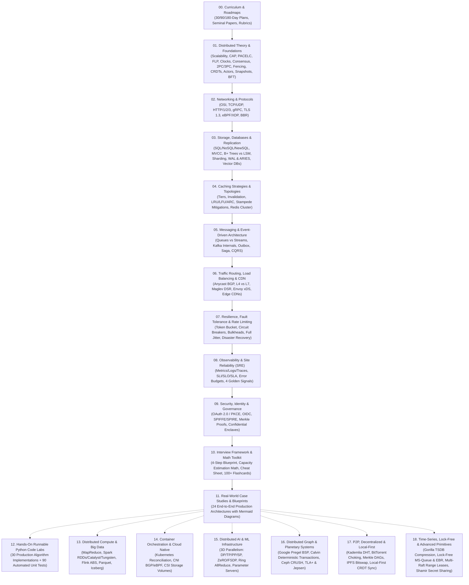
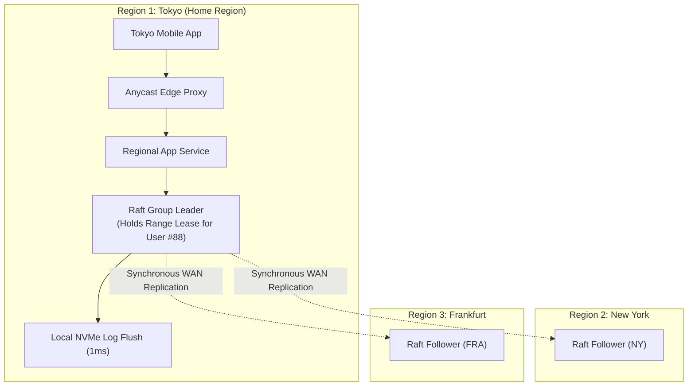
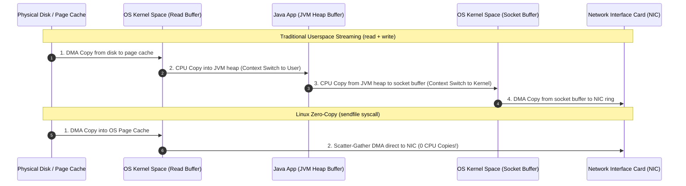
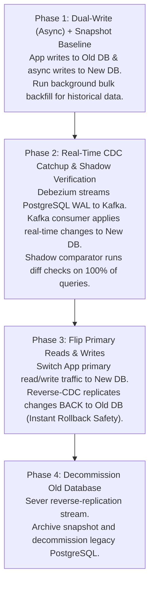

# 🌐 The Master System Design & Distributed Systems Repository

Welcome to the definitive, zero-to-staff engineering study repository for **System Design and Globally Distributed Systems**. 

Whether you are an absolute beginner learning how web servers handle traffic, a senior engineer preparing for top-tier systems design interviews (FAANG / MAMAA / Unicorns), or a staff architect designing fault-tolerant multi-region cloud backbones, this repository is built to be your single, exhaustive source of truth.

---

## 🗺️ Master Curriculum Roadmap



---

## 📚 Complete Table of Contents & File Directory

### [00_CURRICULUM_AND_ROADMAP](file:///home/prasanta/Documents/learning_folder/system_design/00_CURRICULUM_AND_ROADMAP/)
*Your strategic learning plan and assessment guide.*
- [01. Beginner-to-Staff Systems Engineering Roadmap](file:///home/prasanta/Documents/learning_folder/system_design/00_CURRICULUM_AND_ROADMAP/01_beginner_to_staff_roadmap.md) — The 6-phase journey from simple web tier to global multi-region architect.
- [02. Study Schedules: 30, 90, and 180 Days](file:///home/prasanta/Documents/learning_folder/system_design/00_CURRICULUM_AND_ROADMAP/02_study_schedules_30_90_180_days.md) — Daily/weekly milestone blueprints tailored to your timeline.
- [03. Seminal Distributed Systems Papers & Reading List](file:///home/prasanta/Documents/learning_folder/system_design/00_CURRICULUM_AND_ROADMAP/03_seminal_papers_and_reading_list.md) — Deep summaries of Dynamo, Raft, Spanner, Bigtable, Kafka, Chandy-Lamport, PBFT, Spark, and HNSW.
- [04. Interview Evaluation Rubric & Seniority Matrix](file:///home/prasanta/Documents/learning_folder/system_design/00_CURRICULUM_AND_ROADMAP/04_interview_evaluation_rubric.md) — How Staff/Principal interviewers evaluate candidates (L4 vs L5 vs L6 vs L7).

---

### [01_FOUNDATIONS_AND_PRINCIPLES](file:///home/prasanta/Documents/learning_folder/system_design/01_FOUNDATIONS_AND_PRINCIPLES/)
*The fundamental laws, consensus proofs, and synchronization models.*
- [01. Core System Qualities & Non-Functionals](file:///home/prasanta/Documents/learning_folder/system_design/01_FOUNDATIONS_AND_PRINCIPLES/01_core_system_qualities.md) — Scalability, Table of Nines, Reliability, Latency vs. Throughput, Fan-out tail latency.
- [02. Distributed Systems Theorems: CAP, PACELC, FLP & BFT](file:///home/prasanta/Documents/learning_folder/system_design/01_FOUNDATIONS_AND_PRINCIPLES/02_distributed_systems_theorems.md) — Formal proofs, why CA is a myth, PACELC matrix, and Byzantine Fault Tolerance.
- [03. Consistency Models Hierarchy](file:///home/prasanta/Documents/learning_folder/system_design/01_FOUNDATIONS_AND_PRINCIPLES/03_consistency_models_hierarchy.md) — Linearizable, Sequential, Causal, Read-Your-Writes, Eventual, and CRDTs.
- [04. Clocks, Time, and Ordering](file:///home/prasanta/Documents/learning_folder/system_design/01_FOUNDATIONS_AND_PRINCIPLES/04_clocks_time_and_ordering.md) — Physical NTP drift, Lamport Timestamps, Vector Clocks, and Google TrueTime Commit Wait.
- [05. Consensus Algorithms: Paxos, Raft, ZAB & Gossip](file:///home/prasanta/Documents/learning_folder/system_design/01_FOUNDATIONS_AND_PRINCIPLES/05_consensus_algorithms.md) — State Machine Replication, Raft sub-problems, Split votes, and SWIM gossip.
- [06. Hybrid Logical Clocks (HLC) & Physical Time](file:///home/prasanta/Documents/learning_folder/system_design/01_FOUNDATIONS_AND_PRINCIPLES/06_hybrid_logical_clocks_hlc.md) — Bounding physical NTP drift with logical tie-breaking (CockroachDB / MongoDB).
- [07. Distributed Transactions: 2PC, 3PC & Atomic Commit](file:///home/prasanta/Documents/learning_folder/system_design/01_FOUNDATIONS_AND_PRINCIPLES/07_distributed_transactions_2pc_3pc.md) — Prepare & Commit phases, Skeen's 3PC non-blocking proof, and Raft-replicated 2PC.
- [08. Distributed Locking & Fencing Tokens](file:///home/prasanta/Documents/learning_folder/system_design/01_FOUNDATIONS_AND_PRINCIPLES/08_distributed_locking_fencing_tokens.md) — The Redlock controversy (Kleppmann vs Antirez), Chubby sequencers, and storage validation.
- [09. Conflict-Free Replicated Data Types (CRDTs)](file:///home/prasanta/Documents/learning_folder/system_design/01_FOUNDATIONS_AND_PRINCIPLES/09_crdt_deep_dive_state_vs_operation.md) — State (CvRDT) vs Operation (CmRDT) CRDTs, Join-Semilattices ($\sqcup$), PN-Counter, OR-Set, Yjs.
- [10. The Actor Model & Microsoft Orleans Virtual Actors](file:///home/prasanta/Documents/learning_folder/system_design/01_FOUNDATIONS_AND_PRINCIPLES/10_actor_model_and_virtual_actors.md) — Hewitt's axioms, Erlang/OTP supervision trees, Orleans Virtual Grains lifecycle and placement.
- [11. Chandy-Lamport Distributed Snapshots & Cuts](file:///home/prasanta/Documents/learning_folder/system_design/01_FOUNDATIONS_AND_PRINCIPLES/11_chandy_lamport_distributed_snapshots.md) — Non-blocking global state capture, Marker message protocol, FIFO channel invariants, Consistent Cuts.
- [12. Failure Detectors & The Phi ($\Phi$) Accrual Algorithm](file:///home/prasanta/Documents/learning_folder/system_design/01_FOUNDATIONS_AND_PRINCIPLES/12_failure_detectors_and_phi_accrual.md) — Chandra-Toueg hierarchy, Gaussian heartbeat interval modeling, Cassandra suspicion thresholds.
- [13. Byzantine Fault Tolerance: PBFT & HotStuff](file:///home/prasanta/Documents/learning_folder/system_design/01_FOUNDATIONS_AND_PRINCIPLES/13_byzantine_fault_tolerance_pbft_and_hotstuff.md) — $3f+1$ pigeonhole proof, PBFT 3-phase protocol, HotStuff linear view change ($O(N)$), Chained 3-phase BFT.

---

### [02_NETWORKING_AND_PROTOCOLS](file:///home/prasanta/Documents/learning_folder/system_design/02_NETWORKING_AND_PROTOCOLS/)
*Transport layers, wire protocols, congestion control, and kernel bypass.*
- [01. OSI Model and Transport Layers: TCP vs. UDP](file:///home/prasanta/Documents/learning_folder/system_design/02_NETWORKING_AND_PROTOCOLS/01_osi_model_and_transport_layers.md) — 3-way handshake, TIME_WAIT socket exhaustion, Flow control, HoL blocking, MTU/MSS.
- [02. Evolution of HTTP: HTTP/1.0, 1.1, 2, and 3 (QUIC)](file:///home/prasanta/Documents/learning_folder/system_design/02_NETWORKING_AND_PROTOCOLS/02_http_evolution.md) — Keep-Alive, Binary framing, Multiplexing, UDP-based QUIC, 0-RTT handshakes, Connection migration.
- [03. Communication Patterns: REST, GraphQL, gRPC, WebSockets & SSE](file:///home/prasanta/Documents/learning_folder/system_design/02_NETWORKING_AND_PROTOCOLS/03_communication_patterns.md) — Verb idempotency, Protobuf serialization, Full-duplex WebSockets, SSE token streaming.
- [04. TLS Security, Handshakes & Connection Management](file:///home/prasanta/Documents/learning_folder/system_design/02_NETWORKING_AND_PROTOCOLS/04_tls_security_and_connections.md) — TLS 1.2 vs 1.3, mTLS Zero Trust, Connection pooling mechanics, TCP vs HTTP keepalive.
- [05. Advanced Networking: eBPF/XDP, BBR Congestion Control & QUIC](file:///home/prasanta/Documents/learning_folder/system_design/02_NETWORKING_AND_PROTOCOLS/05_advanced_networking_ebpf_bbr_and_quic_internals.md) — Linux kernel `sk_buff` bottlenecks, eBPF line-rate drops, Google BBR vs CUBIC, QPACK streams.

---

### [03_STORAGE_DATABASES_AND_REPLICATION](file:///home/prasanta/Documents/learning_folder/system_design/03_STORAGE_DATABASES_AND_REPLICATION/)
*Data persistence, consistency, indexing, and sharding.*
- [01. Database Paradigms: Relational vs. NoSQL vs. NewSQL](file:///home/prasanta/Documents/learning_folder/system_design/03_STORAGE_DATABASES_AND_REPLICATION/01_relational_vs_nosql_vs_newsql.md) — RDBMS vs Key-Value vs Document vs Wide-Column vs Graph vs Time-Series vs Spanner.
- [02. ACID Transactions, Isolation Levels & MVCC](file:///home/prasanta/Documents/learning_folder/system_design/03_STORAGE_DATABASES_AND_REPLICATION/02_acid_transactions_and_isolation.md) — Dirty/Fuzzy/Phantom reads, Write Skew, Multi-Version Concurrency Control, Serializable SI.
- [03. Storage Engines: B+ Trees vs. LSM-Trees](file:///home/prasanta/Documents/learning_folder/system_design/03_STORAGE_DATABASES_AND_REPLICATION/03_storage_engines_and_indexing.md) — B+ Tree fan-out, LSM MemTable, WAL, SSTables, Bloom filters, Compaction, Inverted indexes.
- [04. Database Partitioning and Sharding Strategies](file:///home/prasanta/Documents/learning_folder/system_design/03_STORAGE_DATABASES_AND_REPLICATION/04_partitioning_and_sharding.md) — Range sharding, Modulo hashing pitfalls, Consistent Hashing ring, Scatter-gather, Salted keys.
- [05. Database Replication Strategies: Single-Leader, Multi-Leader & Leaderless](file:///home/prasanta/Documents/learning_folder/system_design/03_STORAGE_DATABASES_AND_REPLICATION/05_replication_strategies.md) — Replication lag, Fencing tokens, Quorum condition ($W+R>N$), Read Repair, Merkle Trees.
- [06. LSM Compaction Strategies, WAL Internals & ARIES Crash Recovery](file:///home/prasanta/Documents/learning_folder/system_design/03_STORAGE_DATABASES_AND_REPLICATION/06_lsm_compaction_and_wal_recovery.md) — Size-Tiered vs Leveled (LCS) vs Time-Window compaction, Tombstones, WAL group commit, ARIES Recovery Algorithm.
- [07. Vector Databases & Approximate Nearest Neighbor (ANN) Search](file:///home/prasanta/Documents/learning_folder/system_design/03_STORAGE_DATABASES_AND_REPLICATION/07_vector_databases_and_similarity_search.md) — Cosine/Dot Product/L2 distance, HNSW multi-layer graphs, IVF-PQ quantization, Single-stage filtering.

---

### [04_CACHING_STRATEGIES_AND_PATTERNS](file:///home/prasanta/Documents/learning_folder/system_design/04_CACHING_STRATEGIES_AND_PATTERNS/)
*In-memory acceleration and protection.*
- [01. Caching Topologies & Multi-Tier Hierarchy](file:///home/prasanta/Documents/learning_folder/system_design/04_CACHING_STRATEGIES_AND_PATTERNS/01_caching_topologies_and_tiers.md) — Browser $\to$ CDN $\to$ Reverse Proxy $\to$ App Heap $\to$ Distributed Cache $\to$ DB Buffer Pool.
- [02. Cache Invalidation and Mutation Patterns](file:///home/prasanta/Documents/learning_folder/system_design/04_CACHING_STRATEGIES_AND_PATTERNS/02_cache_invalidation_patterns.md) — Cache-Aside, Read-Through, Write-Through, Write-Behind, Refresh-Ahead. Why update DB then delete cache.
- [03. Cache Eviction Policies: LRU, LFU, FIFO, 2Q & ARC](file:///home/prasanta/Documents/learning_folder/system_design/04_CACHING_STRATEGIES_AND_PATTERNS/03_cache_eviction_policies.md) — $O(1)$ implementations, Scan resistance failures, Adaptive Replacement Cache (ARC).
- [04. Cache Anomalies & Mitigations](file:///home/prasanta/Documents/learning_folder/system_design/04_CACHING_STRATEGIES_AND_PATTERNS/04_cache_anomalies_and_mitigation.md) — Cache Stampede (XFetch), Cache Penetration (Bloom filters), Cache Avalanche (TTL Jitter).
- [05. Distributed Redis Architecture](file:///home/prasanta/Documents/learning_folder/system_design/04_CACHING_STRATEGIES_AND_PATTERNS/05_distributed_redis_architecture.md) — Single-threaded event loop, RDB/AOF persistence, Sentinel failover, 16,384 Hash slots, Hash tags.

---

### [05_MESSAGING_EVENT_DRIVEN_AND_ASYNC](file:///home/prasanta/Documents/learning_folder/system_design/05_MESSAGING_EVENT_DRIVEN_AND_ASYNC/)
*Asynchronous decoupling and event logs.*
- [01. Message Queues vs. Distributed Event Streams](file:///home/prasanta/Documents/learning_folder/system_design/05_MESSAGING_EVENT_DRIVEN_AND_ASYNC/01_message_queues_vs_event_streams.md) — Destructive consumer queues (RabbitMQ) vs Persistent re-playable logs (Kafka), Backpressure.
- [02. Delivery Semantics & Exactly-Once Processing](file:///home/prasanta/Documents/learning_folder/system_design/05_MESSAGING_EVENT_DRIVEN_AND_ASYNC/02_delivery_semantics_and_guarantees.md) — At-most-once, At-least-once, True Exactly-Once formula, Idempotency keys, Kafka transactions.
- [03. Apache Kafka Deep Dive](file:///home/prasanta/Documents/learning_folder/system_design/05_MESSAGING_EVENT_DRIVEN_AND_ASYNC/03_kafka_deep_dive.md) — Topics, Partitions, ISR, Consumer groups, Linux Zero-Copy (`sendfile`), KRaft metadata mode.
- [04. Event-Driven Patterns: Outbox, Saga, CDC & CQRS](file:///home/prasanta/Documents/learning_folder/system_design/05_MESSAGING_EVENT_DRIVEN_AND_ASYNC/04_event_driven_design_patterns.md) — Dual-write problem, Transactional Outbox, Debezium CDC, Saga Orchestration, CQRS, Event Sourcing.

---

### [06_TRAFFIC_ROUTING_LOAD_BALANCING_CDN](file:///home/prasanta/Documents/learning_folder/system_design/06_TRAFFIC_ROUTING_LOAD_BALANCING_CDN/)
*Global traffic management and edge acceleration.*
- [01. DNS Resolution, GeoDNS & Anycast BGP](file:///home/prasanta/Documents/learning_folder/system_design/06_TRAFFIC_ROUTING_LOAD_BALANCING_CDN/01_dns_and_anycast_routing.md) — DNS resolution hierarchy, GeoDNS, Anycast global IP routing, Zero-TTL instant failover.
- [02. Load Balancing: Layer 4 vs. Layer 7](file:///home/prasanta/Documents/learning_folder/system_design/06_TRAFFIC_ROUTING_LOAD_BALANCING_CDN/02_load_balancing_l4_vs_l7.md) — L4 Direct Server Return (Maglev/IPVS) vs L7 Application Routing (Envoy/Nginx), Two-tier topology.
- [03. Load Balancing Algorithms & Health Checks](file:///home/prasanta/Documents/learning_folder/system_design/06_TRAFFIC_ROUTING_LOAD_BALANCING_CDN/03_load_balancing_algorithms.md) — Round Robin, Least Conn, Peak EWMA, Power of Two Random Choices (P2C), Outlier detection.
- [04. Content Delivery Networks (CDNs) & Edge Computing](file:///home/prasanta/Documents/learning_folder/system_design/06_TRAFFIC_ROUTING_LOAD_BALANCING_CDN/04_content_delivery_networks_cdn.md) — Push vs Pull, Origin Shield, Dynamic Site Acceleration (DSA), Surrogate keys (`Cache-Tag`), Stale-while-revalidate.
- [05. Service Mesh, Envoy Proxy & Google Maglev Deep Dive](file:///home/prasanta/Documents/learning_folder/system_design/06_TRAFFIC_ROUTING_LOAD_BALANCING_CDN/05_service_mesh_envoy_and_maglev_deep_dive.md) — Maglev consistent hashing lookup table, DSR asymmetric bypass, Envoy xDS APIs, Hedged requests.

---

### [07_RESILIENCE_FAULT_TOLERANCE_RATE_LIMITING](file:///home/prasanta/Documents/learning_folder/system_design/07_RESILIENCE_FAULT_TOLERANCE_RATE_LIMITING/)
*Defensive engineering and survival under catastrophic conditions.*
- [01. Rate Limiting Algorithms](file:///home/prasanta/Documents/learning_folder/system_design/07_RESILIENCE_FAULT_TOLERANCE_RATE_LIMITING/01_rate_limiting_algorithms.md) — Token Bucket, Leaky Bucket, Fixed Window, Sliding Window Log, Sliding Window Counter.
- [02. Distributed Rate Limiting: Redis & Lua Scripts](file:///home/prasanta/Documents/learning_folder/system_design/07_RESILIENCE_FAULT_TOLERANCE_RATE_LIMITING/02_distributed_rate_limiting.md) — Atomic Redis Lua scripts, Local token batch reservation, RFC 6585 headers, Multi-tier throttling.
- [03. Circuit Breakers, Bulkheads & Retries with Jitter](file:///home/prasanta/Documents/learning_folder/system_design/07_RESILIENCE_FAULT_TOLERANCE_RATE_LIMITING/03_circuit_breakers_and_bulkheads.md) — Closed/Open/Half-Open states, Thread pool bulkheads, Full Jitter mathematical formula.
- [04. High Availability, Disaster Recovery & Chaos Engineering](file:///home/prasanta/Documents/learning_folder/system_design/07_RESILIENCE_FAULT_TOLERANCE_RATE_LIMITING/04_high_availability_disaster_recovery.md) — Active-Active vs Active-Passive, RPO vs RTO, Fencing Tokens, Load shedding, Chaos Monkey.

---

### [08_OBSERVABILITY_MONITORING_RELIABILITY](file:///home/prasanta/Documents/learning_folder/system_design/08_OBSERVABILITY_MONITORING_RELIABILITY/)
*Operational visibility and Site Reliability Engineering.*
- [01. The Three Pillars of Observability](file:///home/prasanta/Documents/learning_folder/system_design/08_OBSERVABILITY_MONITORING_RELIABILITY/01_three_pillars_of_observability.md) — Metrics (Prometheus), Structured JSON Logs, Distributed Tracing (OpenTelemetry Spans).
- [02. SLIs, SLOs, SLAs, and Error Budgets](file:///home/prasanta/Documents/learning_folder/system_design/08_OBSERVABILITY_MONITORING_RELIABILITY/02_sli_slo_sla_and_error_budgets.md) — Google SRE math, Error budget feature-freeze governance, Burn rate alerting.
- [03. SRE Golden Signals, RED/USE & OpenTelemetry](file:///home/prasanta/Documents/learning_folder/system_design/08_OBSERVABILITY_MONITORING_RELIABILITY/03_sre_golden_signals_and_telemetry.md) — Latency, Traffic, Errors, Saturation; RED vs USE; OTel Collector architecture.

---

### [09_SECURITY_IDENTITY_AND_GOVERNANCE](file:///home/prasanta/Documents/learning_folder/system_design/09_SECURITY_IDENTITY_AND_GOVERNANCE/)
*Zero Trust identity, cryptographic proofs, and data protection.*
- [01. Authentication, Authorization, OAuth 2.0 & JWTs](file:///home/prasanta/Documents/learning_folder/system_design/09_SECURITY_IDENTITY_AND_GOVERNANCE/01_authentication_and_authorization.md) — Auth Code with PKCE, Asymmetric RS256 JWTs, Revocation solutions, RBAC vs ABAC.
- [02. Data Protection, Envelope Encryption & Secrets](file:///home/prasanta/Documents/learning_folder/system_design/09_SECURITY_IDENTITY_AND_GOVERNANCE/02_data_protection_and_encryption.md) — Envelope encryption with KMS, Dynamic secrets with Vault, Crypto-Shredding for GDPR.
- [03. Zero Trust Architecture, WAF & DDoS Defense](file:///home/prasanta/Documents/learning_folder/system_design/09_SECURITY_IDENTITY_AND_GOVERNANCE/03_network_security_and_ddos.md) — BeyondCorp Zero Trust, OWASP WAF rules, SYN Cookie defense, Terabit Anycast scrubbing.
- [04. Workload Identity (SPIFFE/SPIRE), Merkle Proofs & Confidential Enclaves](file:///home/prasanta/Documents/learning_folder/system_design/09_SECURITY_IDENTITY_AND_GOVERNANCE/04_workload_identity_spiffe_spire_and_cryptographic_verification.md) — SVID short-lived certificates, Merkle inclusion proofs, AWS Nitro Enclaves.

---

### [10_SYSTEM_DESIGN_INTERVIEW_FRAMEWORK](file:///home/prasanta/Documents/learning_folder/system_design/10_SYSTEM_DESIGN_INTERVIEW_FRAMEWORK/)
*The interview battle-tested toolkit.*
- [01. The 4-Step System Design Interview Blueprint](file:///home/prasanta/Documents/learning_folder/system_design/10_SYSTEM_DESIGN_INTERVIEW_FRAMEWORK/01_four_step_interview_blueprint.md) — 45-minute pacing guide, scoping, data models, deep dives, wrap-up.
- [02. Back-of-the-Envelope Capacity Estimation](file:///home/prasanta/Documents/learning_folder/system_design/10_SYSTEM_DESIGN_INTERVIEW_FRAMEWORK/02_back_of_the_envelope_estimation.md) — Latency numbers, Powers of Two, QPS/Storage/Bandwidth/RAM math with Twitter solved example.
- [03. The Ultimate System Design Cheat Sheet](file:///home/prasanta/Documents/learning_folder/system_design/10_SYSTEM_DESIGN_INTERVIEW_FRAMEWORK/03_system_design_cheat_sheet.md) — One-stop decision trees, trade-off matrix, and high-yield rules of thumb.
- [04. System Design Interview Flashcards (Active Recall)](file:///home/prasanta/Documents/learning_folder/system_design/10_SYSTEM_DESIGN_INTERVIEW_FRAMEWORK/04_interview_qa_flashcards.md) — High-yield Q&A cards covering all foundational concepts.

---

### [11_CASE_STUDIES_ARCHITECTURAL_BLUEPRINTS](file:///home/prasanta/Documents/learning_folder/system_design/11_CASE_STUDIES_ARCHITECTURAL_BLUEPRINTS/)
*24 end-to-end production architectures with Mermaid sequence and flow diagrams.*
1. [01. URL Shortener (TinyURL / Bitly)](file:///home/prasanta/Documents/learning_folder/system_design/11_CASE_STUDIES_ARCHITECTURAL_BLUEPRINTS/01_url_shortener_tinyurl.md) — Base62, Key Generation Service (KGS), 301 vs 302 redirects, DynamoDB.
2. [02. Distributed Rate Limiter Service](file:///home/prasanta/Documents/learning_folder/system_design/11_CASE_STUDIES_ARCHITECTURAL_BLUEPRINTS/02_rate_limiter_service.md) — Sliding window counter Lua script, Fail-Open vs Fail-Closed, Multi-tier throttling.
3. [03. Distributed Key-Value Store (Dynamo-Style)](file:///home/prasanta/Documents/learning_folder/system_design/11_CASE_STUDIES_ARCHITECTURAL_BLUEPRINTS/03_distributed_key_value_store.md) — Quorum consensus ($W+R>N$), Vector Clocks, Hinted Handoff, Merkle Trees.
4. [04. Distributed Unique ID Generator (Snowflake)](file:///home/prasanta/Documents/learning_folder/system_design/11_CASE_STUDIES_ARCHITECTURAL_BLUEPRINTS/04_distributed_unique_id_generator.md) — 64-bit layout, 41-bit timestamp, Worker ID allocation, Clock drift protection.
5. [05. Social Media Feed System (Twitter / X)](file:///home/prasanta/Documents/learning_folder/system_design/11_CASE_STUDIES_ARCHITECTURAL_BLUEPRINTS/05_social_media_feed_twitter_x.md) — Fan-out on write vs Fan-out on read, Hybrid celebrity fanout, Redis timeline caches.
6. [06. Real-Time Chat System (WhatsApp / Slack)](file:///home/prasanta/Documents/learning_folder/system_design/11_CASE_STUDIES_ARCHITECTURAL_BLUEPRINTS/06_realtime_chat_messaging_whatsapp.md) — WebSockets, Session locator cluster, Cassandra timeuuid log, Presence heartbeats.
7. [07. Video Streaming Platform (YouTube / Netflix)](file:///home/prasanta/Documents/learning_folder/system_design/11_CASE_STUDIES_ARCHITECTURAL_BLUEPRINTS/07_video_streaming_netflix_youtube.md) — GOP chunking, Transcoding DAG, Adaptive Bitrate Streaming (HLS/DASH), Open Connect ISP appliances.
8. [08. Ride-Sharing Dispatch System (Uber / Lyft)](file:///home/prasanta/Documents/learning_folder/system_design/11_CASE_STUDIES_ARCHITECTURAL_BLUEPRINTS/08_ride_sharing_uber_lyft.md) — Hexagonal spatial indexing (Uber H3), Driver GPS ingestion at scale, Distributed lock matching.
9. [09. Distributed Web Crawler & Indexer (Googlebot)](file:///home/prasanta/Documents/learning_folder/system_design/11_CASE_STUDIES_ARCHITECTURAL_BLUEPRINTS/09_web_crawler_and_indexer.md) — URL Frontier, Priority vs Politeness queues, SimHash deduplication, Inverted indexes.
10. [10. Collaborative Real-Time Editor (Google Docs / Figma)](file:///home/prasanta/Documents/learning_folder/system_design/11_CASE_STUDIES_ARCHITECTURAL_BLUEPRINTS/10_collaborative_editor_google_docs.md) — Operational Transformation (OT) vs CRDTs (Yjs/Automerge), Fractional indexing, Convergence.
11. [11. Distributed Job Scheduler (Temporal / Celery)](file:///home/prasanta/Documents/learning_folder/system_design/11_CASE_STUDIES_ARCHITECTURAL_BLUEPRINTS/11_distributed_job_scheduler.md) — Delayed Redis ZSET index, `FOR UPDATE SKIP LOCKED`, Worker heartbeat leasing, Dead letter queues.
12. [12. Financial Payment System & Ledger (Stripe-Like)](file:///home/prasanta/Documents/learning_folder/system_design/11_CASE_STUDIES_ARCHITECTURAL_BLUEPRINTS/12_payment_system_stripe_like.md) — Double-entry bookkeeping, Absolute idempotency keys, Card tokenization, Daily bank reconciliation.
13. [13. Global Multi-Channel Notification Engine](file:///home/prasanta/Documents/learning_folder/system_design/11_CASE_STUDIES_ARCHITECTURAL_BLUEPRINTS/13_notification_system.md) — APNS/FCM/SMS/Email, Priority isolation queues, User quiet hours, Vendor circuit breakers.
14. [14. Distributed In-Memory Cache Cluster](file:///home/prasanta/Documents/learning_folder/system_design/11_CASE_STUDIES_ARCHITECTURAL_BLUEPRINTS/14_distributed_cache_cluster.md) — Smart client routing, 16,384 Hash slots, Live slot migration, Gossip failover voting, Slab allocation.
15. [15. Search Autocomplete & Typeahead System](file:///home/prasanta/Documents/learning_folder/system_design/11_CASE_STUDIES_ARCHITECTURAL_BLUEPRINTS/15_search_autocomplete_typeahead.md) — Prefix Trie, Top-K Node caching, Asynchronous MapReduce aggregation, Frequency decay.
16. [16. Ticketmaster Flash Sale Ticket Booking](file:///home/prasanta/Documents/learning_folder/system_design/11_CASE_STUDIES_ARCHITECTURAL_BLUEPRINTS/16_ticketmaster_flash_sale_booking.md) — Virtual Waiting Room (Queue-it), Redis Lua inventory holds, Optimistic Concurrency Control (OCC).
17. [17. Top-K Heavy Hitters & Trending Topics](file:///home/prasanta/Documents/learning_folder/system_design/11_CASE_STUDIES_ARCHITECTURAL_BLUEPRINTS/17_top_k_heavy_hitters_trending.md) — Count-Min Sketch, Space-Saving algorithm, Sliding/Tumbling stream windows with Apache Flink.
18. [18. Large Language Model (LLM) Serving & RAG Pipeline](file:///home/prasanta/Documents/learning_folder/system_design/11_CASE_STUDIES_ARCHITECTURAL_BLUEPRINTS/18_llm_serving_and_rag_pipeline.md) — vLLM PagedAttention, KV cache management, Continuous batching, HNSW vector search, Semantic caching.
19. [19. Ultra-Low Latency Trading Engine (CLOB)](file:///home/prasanta/Documents/learning_folder/system_design/11_CASE_STUDIES_ARCHITECTURAL_BLUEPRINTS/19_ultra_low_latency_trading_engine.md) — Central Limit Order Book, LMAX Disruptor lock-free ring buffer, Deterministic execution, Kernel bypass.
20. [20. Distributed Object Store (Amazon S3-Compatible)](file:///home/prasanta/Documents/learning_folder/system_design/11_CASE_STUDIES_ARCHITECTURAL_BLUEPRINTS/20_distributed_object_store_s3.md) — Decoupled metadata/data planes, Append-only volume files, Reed-Solomon Erasure Coding (8+4).
21. [21. Real-Time Ad Click Aggregation & Billing](file:///home/prasanta/Documents/learning_folder/system_design/11_CASE_STUDIES_ARCHITECTURAL_BLUEPRINTS/21_ad_click_aggregation_billing.md) — Kappa architecture, Flink exactly-once checkpointing (Chandy-Lamport), Watermarks, Fraud scrubbing.
22. [22. Modern Data Lakehouse Platform (Apache Iceberg & Trino)](file:///home/prasanta/Documents/learning_folder/system_design/11_CASE_STUDIES_ARCHITECTURAL_BLUEPRINTS/22_modern_data_lakehouse_analytics_iceberg.md) — Open table formats, Manifest trees, Merge-on-Read with delete vectors, sub-second interactive BI SQL.
23. [23. Hyperscale Kubernetes Platform & eBPF Service Mesh](file:///home/prasanta/Documents/learning_folder/system_design/11_CASE_STUDIES_ARCHITECTURAL_BLUEPRINTS/23_kubernetes_cloud_native_service_mesh.md) — Cilium eBPF socket layer bypass (`sockops`), Envoy xDS dynamic control plane, SPIRE short-lived zero-trust mTLS.
24. [24. Distributed Vector Database Engine (10 Billion Vectors)](file:///home/prasanta/Documents/learning_folder/system_design/11_CASE_STUDIES_ARCHITECTURAL_BLUEPRINTS/24_distributed_vector_database_engine.md) — Decoupled coordinator/query/data plane, Growing vs Sealed segments, Out-of-core DiskANN NVMe I/O (`io_uring`).

---

### [12_HANDS_ON_RUNNABLE_LABS](file:///home/prasanta/Documents/learning_folder/system_design/12_HANDS_ON_RUNNABLE_LABS/)
*30 runnable Python algorithm implementations with automated unit tests (90 passing tests).*

| Lab | Source Code | Test Suite |
| :--- | :--- | :--- |
| **01. Consistent Hashing Ring** | [consistent_hash.py](file:///home/prasanta/Documents/learning_folder/system_design/12_HANDS_ON_RUNNABLE_LABS/01_consistent_hashing/consistent_hash.py) | [test_consistent_hash.py](file:///home/prasanta/Documents/learning_folder/system_design/12_HANDS_ON_RUNNABLE_LABS/01_consistent_hashing/test_consistent_hash.py) |
| **02. Rate Limiters (Token/Leaky/Sliding)** | [rate_limiters.py](file:///home/prasanta/Documents/learning_folder/system_design/12_HANDS_ON_RUNNABLE_LABS/02_rate_limiters/rate_limiters.py) | [test_rate_limiters.py](file:///home/prasanta/Documents/learning_folder/system_design/12_HANDS_ON_RUNNABLE_LABS/02_rate_limiters/test_rate_limiters.py) |
| **03. Bloom Filter** | [bloom_filter.py](file:///home/prasanta/Documents/learning_folder/system_design/12_HANDS_ON_RUNNABLE_LABS/03_bloom_filter/bloom_filter.py) | [test_bloom_filter.py](file:///home/prasanta/Documents/learning_folder/system_design/12_HANDS_ON_RUNNABLE_LABS/03_bloom_filter/test_bloom_filter.py) |
| **04. O(1) LRU & LFU Caches** | [cache_implementations.py](file:///home/prasanta/Documents/learning_folder/system_design/12_HANDS_ON_RUNNABLE_LABS/04_lru_lfu_cache/cache_implementations.py) | [test_cache_implementations.py](file:///home/prasanta/Documents/learning_folder/system_design/12_HANDS_ON_RUNNABLE_LABS/04_lru_lfu_cache/test_cache_implementations.py) |
| **05. Vector Clocks & Causality** | [vector_clock.py](file:///home/prasanta/Documents/learning_folder/system_design/12_HANDS_ON_RUNNABLE_LABS/05_vector_clocks/vector_clock.py) | [test_vector_clock.py](file:///home/prasanta/Documents/learning_folder/system_design/12_HANDS_ON_RUNNABLE_LABS/05_vector_clocks/test_vector_clock.py) |
| **06. Mini-Raft Consensus Simulator** | [mini_raft.py](file:///home/prasanta/Documents/learning_folder/system_design/12_HANDS_ON_RUNNABLE_LABS/06_raft_leader_election/mini_raft.py) | [test_mini_raft.py](file:///home/prasanta/Documents/learning_folder/system_design/12_HANDS_ON_RUNNABLE_LABS/06_raft_leader_election/test_mini_raft.py) |
| **07. Twitter Snowflake ID Generator** | [snowflake.py](file:///home/prasanta/Documents/learning_folder/system_design/12_HANDS_ON_RUNNABLE_LABS/07_snowflake_id_generator/snowflake.py) | [test_snowflake.py](file:///home/prasanta/Documents/learning_folder/system_design/12_HANDS_ON_RUNNABLE_LABS/07_snowflake_id_generator/test_snowflake.py) |
| **08. Geohash & QuadTree Index** | [spatial_index.py](file:///home/prasanta/Documents/learning_folder/system_design/12_HANDS_ON_RUNNABLE_LABS/08_geohash_quadtree/spatial_index.py) | [test_spatial_index.py](file:///home/prasanta/Documents/learning_folder/system_design/12_HANDS_ON_RUNNABLE_LABS/08_geohash_quadtree/test_spatial_index.py) |
| **09. Partitioned Pub-Sub Message Broker**| [message_broker.py](file:///home/prasanta/Documents/learning_folder/system_design/12_HANDS_ON_RUNNABLE_LABS/09_pubsub_message_broker/message_broker.py) | [test_message_broker.py](file:///home/prasanta/Documents/learning_folder/system_design/12_HANDS_ON_RUNNABLE_LABS/09_pubsub_message_broker/test_message_broker.py) |
| **10. API Idempotency Key Engine** | [idempotency_engine.py](file:///home/prasanta/Documents/learning_folder/system_design/12_HANDS_ON_RUNNABLE_LABS/10_idempotency_key_engine/idempotency_engine.py) | [test_idempotency_engine.py](file:///home/prasanta/Documents/learning_folder/system_design/12_HANDS_ON_RUNNABLE_LABS/10_idempotency_key_engine/test_idempotency_engine.py) |
| **11. Distributed Lock & Fencing Tokens** | [distributed_lock.py](file:///home/prasanta/Documents/learning_folder/system_design/12_HANDS_ON_RUNNABLE_LABS/11_distributed_lock_fencing/distributed_lock.py) | [test_distributed_lock.py](file:///home/prasanta/Documents/learning_folder/system_design/12_HANDS_ON_RUNNABLE_LABS/11_distributed_lock_fencing/test_distributed_lock.py) |
| **12. Search Autocomplete Trie** | [autocomplete_trie.py](file:///home/prasanta/Documents/learning_folder/system_design/12_HANDS_ON_RUNNABLE_LABS/12_search_autocomplete_trie/autocomplete_trie.py) | [test_autocomplete_trie.py](file:///home/prasanta/Documents/learning_folder/system_design/12_HANDS_ON_RUNNABLE_LABS/12_search_autocomplete_trie/test_autocomplete_trie.py) |
| **13. Count-Min Sketch & HyperLogLog** | [probabilistic_analytics.py](file:///home/prasanta/Documents/learning_folder/system_design/12_HANDS_ON_RUNNABLE_LABS/13_count_min_hyperloglog/probabilistic_analytics.py) | [test_probabilistic_analytics.py](file:///home/prasanta/Documents/learning_folder/system_design/12_HANDS_ON_RUNNABLE_LABS/13_count_min_hyperloglog/test_probabilistic_analytics.py) |
| **14. Two-Phase Commit (2PC) Protocol** | [two_phase_commit.py](file:///home/prasanta/Documents/learning_folder/system_design/12_HANDS_ON_RUNNABLE_LABS/14_two_phase_commit/two_phase_commit.py) | [test_two_phase_commit.py](file:///home/prasanta/Documents/learning_folder/system_design/12_HANDS_ON_RUNNABLE_LABS/14_two_phase_commit/test_two_phase_commit.py) |
| **15. Circuit Breaker & SingleFlight** | [resilience_patterns.py](file:///home/prasanta/Documents/learning_folder/system_design/12_HANDS_ON_RUNNABLE_LABS/15_circuit_breaker_singleflight/resilience_patterns.py) | [test_resilience_patterns.py](file:///home/prasanta/Documents/learning_folder/system_design/12_HANDS_ON_RUNNABLE_LABS/15_circuit_breaker_singleflight/test_resilience_patterns.py) |
| **16. LSM-Tree Storage Engine** | [lsm_tree.py](file:///home/prasanta/Documents/learning_folder/system_design/12_HANDS_ON_RUNNABLE_LABS/16_lsm_tree_storage_engine/lsm_tree.py) | [test_lsm_tree.py](file:///home/prasanta/Documents/learning_folder/system_design/12_HANDS_ON_RUNNABLE_LABS/16_lsm_tree_storage_engine/test_lsm_tree.py) |
| **17. CRDT (PN-Counter & LWW-Set)** | [crdt_primitives.py](file:///home/prasanta/Documents/learning_folder/system_design/12_HANDS_ON_RUNNABLE_LABS/17_crdt_pn_counter_lww_set/crdt_primitives.py) | [test_crdt_primitives.py](file:///home/prasanta/Documents/learning_folder/system_design/12_HANDS_ON_RUNNABLE_LABS/17_crdt_pn_counter_lww_set/test_crdt_primitives.py) |
| **18. Chandy-Lamport Snapshot** | [chandy_lamport.py](file:///home/prasanta/Documents/learning_folder/system_design/12_HANDS_ON_RUNNABLE_LABS/18_chandy_lamport_snapshot/chandy_lamport.py) | [test_chandy_lamport.py](file:///home/prasanta/Documents/learning_folder/system_design/12_HANDS_ON_RUNNABLE_LABS/18_chandy_lamport_snapshot/test_chandy_lamport.py) |
| **19. Vector Search (HNSW & PQ)** | [vector_engine.py](file:///home/prasanta/Documents/learning_folder/system_design/12_HANDS_ON_RUNNABLE_LABS/19_vector_search_hnsw_pq/vector_engine.py) | [test_vector_engine.py](file:///home/prasanta/Documents/learning_folder/system_design/12_HANDS_ON_RUNNABLE_LABS/19_vector_search_hnsw_pq/test_vector_engine.py) |
| **20. Phi ($\Phi$) Failure Detector** | [failure_detector.py](file:///home/prasanta/Documents/learning_folder/system_design/12_HANDS_ON_RUNNABLE_LABS/20_phi_accrual_failure_detector/failure_detector.py) | [test_failure_detector.py](file:///home/prasanta/Documents/learning_folder/system_design/12_HANDS_ON_RUNNABLE_LABS/20_phi_accrual_failure_detector/test_failure_detector.py) |
| **21. Columnar Storage Engine** | [columnar_engine.py](file:///home/prasanta/Documents/learning_folder/system_design/12_HANDS_ON_RUNNABLE_LABS/21_columnar_storage_vectorized/columnar_engine.py) | [test_columnar_engine.py](file:///home/prasanta/Documents/learning_folder/system_design/12_HANDS_ON_RUNNABLE_LABS/21_columnar_storage_vectorized/test_columnar_engine.py) |
| **22. K8s Reconciliation Loop** | [controller_simulator.py](file:///home/prasanta/Documents/learning_folder/system_design/12_HANDS_ON_RUNNABLE_LABS/22_kubernetes_reconciliation_loop/controller_simulator.py) | [test_controller_simulator.py](file:///home/prasanta/Documents/learning_folder/system_design/12_HANDS_ON_RUNNABLE_LABS/22_kubernetes_reconciliation_loop/test_controller_simulator.py) |
| **23. Ring AllReduce Collective** | [ring_allreduce.py](file:///home/prasanta/Documents/learning_folder/system_design/12_HANDS_ON_RUNNABLE_LABS/23_ring_allreduce_collective/ring_allreduce.py) | [test_ring_allreduce.py](file:///home/prasanta/Documents/learning_folder/system_design/12_HANDS_ON_RUNNABLE_LABS/23_ring_allreduce_collective/test_ring_allreduce.py) |
| **24. Pregel Graph Processing Engine**| [pregel_engine.py](file:///home/prasanta/Documents/learning_folder/system_design/12_HANDS_ON_RUNNABLE_LABS/24_pregel_graph_processing/pregel_engine.py) | [test_pregel_engine.py](file:///home/prasanta/Documents/learning_folder/system_design/12_HANDS_ON_RUNNABLE_LABS/24_pregel_graph_processing/test_pregel_engine.py) |
| **25. Ceph CRUSH Placement** | [crush_algorithm.py](file:///home/prasanta/Documents/learning_folder/system_design/12_HANDS_ON_RUNNABLE_LABS/25_ceph_crush_algorithm/crush_algorithm.py) | [test_crush_algorithm.py](file:///home/prasanta/Documents/learning_folder/system_design/12_HANDS_ON_RUNNABLE_LABS/25_ceph_crush_algorithm/test_crush_algorithm.py) |
| **26. Linearizability Checker** | [linearizability_checker.py](file:///home/prasanta/Documents/learning_folder/system_design/12_HANDS_ON_RUNNABLE_LABS/26_linearizability_checker/linearizability_checker.py) | [test_linearizability_checker.py](file:///home/prasanta/Documents/learning_folder/system_design/12_HANDS_ON_RUNNABLE_LABS/26_linearizability_checker/test_linearizability_checker.py) |
| **27. Kademlia DHT Routing Engine** | [kademlia_dht.py](file:///home/prasanta/Documents/learning_folder/system_design/12_HANDS_ON_RUNNABLE_LABS/27_kademlia_dht_routing/kademlia_dht.py) | [test_kademlia_dht.py](file:///home/prasanta/Documents/learning_folder/system_design/12_HANDS_ON_RUNNABLE_LABS/27_kademlia_dht_routing/test_kademlia_dht.py) |
| **28. Gorilla TSDB Compression** | [gorilla_codec.py](file:///home/prasanta/Documents/learning_folder/system_design/12_HANDS_ON_RUNNABLE_LABS/28_gorilla_tsdb_compression/gorilla_codec.py) | [test_gorilla_codec.py](file:///home/prasanta/Documents/learning_folder/system_design/12_HANDS_ON_RUNNABLE_LABS/28_gorilla_tsdb_compression/test_gorilla_codec.py) |
| **29. Michael-Scott Lock-Free Queue**| [lock_free_queue.py](file:///home/prasanta/Documents/learning_folder/system_design/12_HANDS_ON_RUNNABLE_LABS/29_michael_scott_lock_free_queue/lock_free_queue.py) | [test_lock_free_queue.py](file:///home/prasanta/Documents/learning_folder/system_design/12_HANDS_ON_RUNNABLE_LABS/29_michael_scott_lock_free_queue/test_lock_free_queue.py) |
| **30. Shamir's Secret Sharing (k, n)** | [shamir_secret.py](file:///home/prasanta/Documents/learning_folder/system_design/12_HANDS_ON_RUNNABLE_LABS/30_shamir_secret_sharing/shamir_secret.py) | [test_shamir_secret.py](file:///home/prasanta/Documents/learning_folder/system_design/12_HANDS_ON_RUNNABLE_LABS/30_shamir_secret_sharing/test_shamir_secret.py) |

#### Run all 90 tests across all 30 labs in one command:
```bash
python3 -m unittest discover -s 12_HANDS_ON_RUNNABLE_LABS -p "test_*.py" -v
```

---

### [13_DISTRIBUTED_COMPUTE_AND_BIG_DATA](file:///home/prasanta/Documents/learning_folder/system_design/13_DISTRIBUTED_COMPUTE_AND_BIG_DATA/)
*Petabyte-scale batch, stream, columnar, and lakehouse storage processing.*
- [01. Distributed Batch Processing: MapReduce & Apache Spark](file:///home/prasanta/Documents/learning_folder/system_design/13_DISTRIBUTED_COMPUTE_AND_BIG_DATA/01_batch_processing_mapreduce_and_spark.md) — RDD lineage graphs, Catalyst Optimizer, Tungsten off-heap execution, Sort-Merge Shuffle.
- [02. Real-Time Stream Processing: Apache Flink & Watermarks](file:///home/prasanta/Documents/learning_folder/system_design/13_DISTRIBUTED_COMPUTE_AND_BIG_DATA/02_stream_processing_flink_and_watermarks.md) — Event vs Processing time, Bounded-out-of-orderness watermarks, RocksDB state, Chandy-Lamport ABS.
- [03. Columnar Storage (Parquet/ORC) & Vectorized Query Engines](file:///home/prasanta/Documents/learning_folder/system_design/13_DISTRIBUTED_COMPUTE_AND_BIG_DATA/03_columnar_storage_and_vectorized_execution.md) — Dremel shredding, Dictionary/RLE/bit-packing, Page min/max pruning, CPU SIMD vector execution (AVX-512).
- [04. The Modern Data Lakehouse: Apache Iceberg & Delta Lake](file:///home/prasanta/Documents/learning_folder/system_design/13_DISTRIBUTED_COMPUTE_AND_BIG_DATA/04_data_lakehouse_table_formats.md) — Open table formats, Manifest trees, Snapshot isolation, Merge-on-Read (MoR) with delete vectors, Time travel.

---

### [14_CLOUD_NATIVE_AND_CONTAINER_ORCHESTRATION](file:///home/prasanta/Documents/learning_folder/system_design/14_CLOUD_NATIVE_AND_CONTAINER_ORCHESTRATION/)
*Declarative systems, kernel-level container networking, and persistent storage.*
- [01. Kubernetes Control Plane Internals & Reconciliation Loops](file:///home/prasanta/Documents/learning_folder/system_design/14_CLOUD_NATIVE_AND_CONTAINER_ORCHESTRATION/01_kubernetes_control_plane_internals.md) — Level-triggered control loops, etcd MVCC watch streams, kube-scheduler 2-phase scoring, kubelet PLEG.
- [02. Container Networking (CNI) & Storage (CSI)](file:///home/prasanta/Documents/learning_folder/system_design/14_CLOUD_NATIVE_AND_CONTAINER_ORCHESTRATION/02_container_networking_cni_and_storage_csi.md) — Linux network namespaces (`netns`), Overlay (VXLAN) vs Flat BGP (Calico) vs Cilium eBPF, CSI volume attachment.

---

### [15_DISTRIBUTED_AI_AND_ML_INFRASTRUCTURE](file:///home/prasanta/Documents/learning_folder/system_design/15_DISTRIBUTED_AI_AND_ML_INFRASTRUCTURE/)
*Scaling large language model training across thousands of GPUs.*
- [01. Distributed Training: 3D Parallelism (DP, TP, PP, SP)](file:///home/prasanta/Documents/learning_folder/system_design/15_DISTRIBUTED_AI_AND_ML_INFRASTRUCTURE/01_distributed_training_parallelism_dp_tp_pp.md) — Megatron-LM tensor column/row parallelism, 1F1B pipeline schedules, Ring Attention sequence parallelism.
- [02. ZeRO (DeepSpeed) & PyTorch Fully Sharded Data Parallel (FSDP)](file:///home/prasanta/Documents/learning_folder/system_design/15_DISTRIBUTED_AI_AND_ML_INFRASTRUCTURE/02_zero_deepspeed_and_fsdp.md) — ZeRO Stages 1, 2, and 3 parameter sharding, AllGather forward/backward lifecycle, CPU offloading.
- [03. Collective Communication: Ring AllReduce, NCCL & RDMA](file:///home/prasanta/Documents/learning_folder/system_design/15_DISTRIBUTED_AI_AND_ML_INFRASTRUCTURE/03_collective_communication_allreduce_and_nccl.md) — Scatter-Reduce and AllGather, bandwidth-optimal $2 \cdot \frac{N-1}{N} \cdot S$, GPUDirect RDMA, InfiniBand vs RoCEv2.
- [04. Parameter Server vs. Decentralized AllReduce](file:///home/prasanta/Documents/learning_folder/system_design/15_DISTRIBUTED_AI_AND_ML_INFRASTRUCTURE/04_parameter_server_vs_decentralized_allreduce.md) — Asynchronous vs Stale Synchronous Parallel (SSP), Sparse recommendation systems (DLRM) vs Dense LLM training.

---

### [16_DISTRIBUTED_GRAPH_AND_PLANETARY_SYSTEMS](file:///home/prasanta/Documents/learning_folder/system_design/16_DISTRIBUTED_GRAPH_AND_PLANETARY_SYSTEMS/)
*Graph algorithms, deterministic NewSQL, disaggregated hardware, and formal methods.*
- [01. Distributed Graph Processing: Google Pregel & BSP](file:///home/prasanta/Documents/learning_folder/system_design/16_DISTRIBUTED_GRAPH_AND_PLANETARY_SYSTEMS/01_distributed_graph_processing_pregel_bsp.md) — "Think Like A Vertex" model, Superstep barrier synchronization, PowerGraph vertex cut vs edge cut.
- [02. Deterministic Transactions: The Calvin Protocol vs. Spanner 2PC](file:///home/prasanta/Documents/learning_folder/system_design/16_DISTRIBUTED_GRAPH_AND_PLANETARY_SYSTEMS/02_deterministic_distributed_transactions_calvin.md) — Pre-execution deterministic sequencing, complete elimination of 2PC, deadlock impossibility.
- [03. Ceph CRUSH Algorithm & Storage Disaggregation (NVMe-oF, CXL)](file:///home/prasanta/Documents/learning_folder/system_design/16_DISTRIBUTED_GRAPH_AND_PLANETARY_SYSTEMS/03_ceph_crush_algorithm_and_storage_disaggregation.md) — Deterministic algorithmic placement without metadata lookup tables, NVMe-oF RoCEv2, SPDK, CXL memory pooling.
- [04. Formal Verification with TLA+ and Jepsen Testing](file:///home/prasanta/Documents/learning_folder/system_design/16_DISTRIBUTED_GRAPH_AND_PLANETARY_SYSTEMS/04_formal_verification_tla_and_jepsen_testing.md) — Leslie Lamport's TLA+ state space model checking, Kyle Kingsbury's Jepsen chaos injection, Hermitage isolation anomalies.

---

### [17_P2P_DECENTRALIZED_AND_LOCAL_FIRST](file:///home/prasanta/Documents/learning_folder/system_design/17_P2P_DECENTRALIZED_AND_LOCAL_FIRST/)
*Peer-to-peer topologies, content-addressed storage, and offline-first collaboration.*
- [01. Kademlia Distributed Hash Table (DHT) & BitTorrent](file:///home/prasanta/Documents/learning_folder/system_design/17_P2P_DECENTRALIZED_AND_LOCAL_FIRST/01_kademlia_dht_and_bittorrent.md) — XOR metric distance, $k$-buckets, $\alpha$-concurrency lookup, BitTorrent tit-for-tat choking, rarest-first piece selection.
- [02. Content-Addressed Storage (CAS) & Merkle DAGs](file:///home/prasanta/Documents/learning_folder/system_design/17_P2P_DECENTRALIZED_AND_LOCAL_FIRST/02_content_addressed_storage_and_merkle_dags.md) — Multihash & CIDv1, IPFS Bitswap & UnixFS topologies, Git DAG internals, packfiles, sliding window delta compression.
- [03. Local-First Software & Offline-First Decentralized Sync](file:///home/prasanta/Documents/learning_folder/system_design/17_P2P_DECENTRALIZED_AND_LOCAL_FIRST/03_local_first_software_and_offline_sync.md) — The 7 Ink & Switch ideals, embedded SQLite/CRDT engines, CouchDB revision trees, state vectors, UCAN capabilities.

---

### [18_TIME_SERIES_LOCK_FREE_AND_ADVANCED_PRIMITIVES](file:///home/prasanta/Documents/learning_folder/system_design/18_TIME_SERIES_LOCK_FREE_AND_ADVANCED_PRIMITIVES/)
*Telemetry compression, non-blocking synchronization, Multi-Raft scalability, and cryptographic trust.*
- [01. Time-Series Databases (TSDB) & Gorilla Compression](file:///home/prasanta/Documents/learning_folder/system_design/18_TIME_SERIES_LOCK_FREE_AND_ADVANCED_PRIMITIVES/01_time_series_databases_gorilla_compression.md) — Delta-of-delta timestamp encoding, IEEE 754 Float64 XOR compression, postings lists, Roaring Bitmaps.
- [02. Lock-Free Algorithms, Memory Models & Safe Reclamation](file:///home/prasanta/Documents/learning_folder/system_design/18_TIME_SERIES_LOCK_FREE_AND_ADVANCED_PRIMITIVES/02_lock_free_algorithms_and_memory_reclamation.md) — CAS vs LL/SC, Acquire-Release semantics, ABA mitigation, Hazard Pointers, Epoch-Based Reclamation (EBR), Michael-Scott queue.
- [03. Multi-Raft Consensus, Range Splitting & Range Leases](file:///home/prasanta/Documents/learning_folder/system_design/18_TIME_SERIES_LOCK_FREE_AND_ADVANCED_PRIMITIVES/03_multi_raft_and_range_leases.md) — Multi-Raft partitioning, dynamic range splitting & merging, CockroachDB range leases for 0-RTT linearizable reads.
- [04. Threshold Cryptography, Secure MPC & Zero-Knowledge Proofs](file:///home/prasanta/Documents/learning_folder/system_design/18_TIME_SERIES_LOCK_FREE_AND_ADVANCED_PRIMITIVES/04_threshold_cryptography_and_zero_knowledge.md) — Shamir's Secret Sharing over $\mathbb{F}_p$, Lagrange interpolation, FROST threshold signatures, Yao's Garbled Circuits, ZK-SNARKs vs ZK-STARKs.

---

## 🎯 Recommended Study Tracks

1. **The 30-Day Interview Sprint:** Start with [02_study_schedules_30_90_180_days.md](file:///home/prasanta/Documents/learning_folder/system_design/00_CURRICULUM_AND_ROADMAP/02_study_schedules_30_90_180_days.md#track-1-the-30-day-interview-sprint), focus on the 4-step interview blueprint, master capacity estimation math, and drill the 24 real-world case studies.
2. **The 90-Day Comprehensive Mastery:** Follow [Track 2](file:///home/prasanta/Documents/learning_folder/system_design/00_CURRICULUM_AND_ROADMAP/02_study_schedules_30_90_180_days.md#track-2-the-90-day-comprehensive-mastery), read all foundational theory modules, inspect storage engine internals, and run all 30 hands-on Python labs.
3. **The 180-Day Staff/Principal Deep Dive:** Follow [Track 3](file:///home/prasanta/Documents/learning_folder/system_design/00_CURRICULUM_AND_ROADMAP/02_study_schedules_30_90_180_days.md#track-3-the-180-day-staffprincipal-systems-architect), read seminal academic papers (Dynamo, Spanner, Raft, Spark, HNSW, PBFT, Calvin, Gorilla, Shamir), study multi-region active-active architectures, and master FinOps cost optimization.


---

## 🎯 Top Real-World Interview Questions & Deep-Dive Answers (FAANG / Staff Level)

### Question 1: How do you design a globally distributed, multi-region database that guarantees sub-50ms read latency worldwide while maintaining strong consistency for financial transactions?
#### The Interviewer's Trap
Candidates often jump to: *"Deploy a multi-master PostgreSQL cluster across US, Europe, and Asia and use asynchronous replication."*
The interviewer will instantly counter: *"What happens when a customer in Tokyo withdraws \$100 while a concurrent automated bill in New York deducts \$100? Asynchronous replication guarantees a double-spend! If you switch to synchronous 2PC across the Pacific, your write latency explodes to 300ms due to the speed of light!"*

#### Staff-Level Model Answer
A production architecture resolves this via **Data Sovereignty Sharding + Consensus Leases**:

1. **Partition by Locality (User Affinity):** $99.9\%$ of transactions for a user occur within their home geographic boundary. Shard account partitions such that the **Raft Consensus Group Leader** for User `#88` is pinned to Tokyo.
2. **Range Leases for 0-RTT Reads:** The leader holds a time-bounded **Range Lease**. As long as the lease is valid, local reads execute in **$< 1\text{ ms}$** directly from the Tokyo leader's RAM without running Paxos/Raft consensus rounds.
3. **Cross-Region Consensus on Writes:** For mutations, Tokyo replicates the WAL to Frankfurt and New York. Because quorum requires only a **majority ($2$ of $3$)**, Tokyo needs an ACK from only the closest follower (e.g. Frankfurt, $\approx 110\text{ms}$), completely hiding the slowest node.
4. **Rare Cross-Region Transfers:** For account-to-account transfers between Tokyo and New York, use a **Saga pattern with Transactional Outbox** and two-phase reservation (freeze balance in Tokyo $\to$ credit in NY) rather than holding blocking multi-region 2PC locks across the globe.

---

### Question 2: In an ultra-high throughput messaging architecture (10M msgs/sec), why does Linux Zero-Copy (`sendfile`) outperform standard userspace file streaming by over 400%?
#### The Interviewer's Trap
Candidates usually describe Kafka as "fast because it is written in Scala/Java and uses threads." 
The interviewer is probing for **Operating System Kernel Mechanics** and **CPU Mechanical Sympathy**.

#### Staff-Level Model Answer
Traditional userspace data transfer requires **4 context switches and 4 memory copies**:

- **The Bottleneck in JVM:** In traditional `InputStream.read()` and `OutputStream.write()`, data is copied across the kernel-user protection boundary twice. This floods the CPU L1/L2 caches with redundant bytes and forces the OS to manage heavy context switches.
- **The Zero-Copy (`sendfile`) Optimization:** The Linux `sendfile(socket_fd, file_fd, offset, count)` system call keeps data entirely inside kernel space. The OS transfers descriptors to the network buffer, and the NIC's **Scatter-Gather DMA** reads data directly from the OS Page Cache into the network packet.
- **Result:** Zero CPU data copying, zero JVM garbage collection allocations, and line-rate saturation of 100 Gbps network interfaces.

---

### Question 3: How do you migrate a 50 Terabyte active PostgreSQL database to a distributed NewSQL cluster (e.g., CockroachDB / Spanner) with strictly zero downtime and zero data loss?
#### The Interviewer's Trap
Candidates often suggest putting the application into "maintenance mode" over the weekend or using batch dump-and-restore (`pg_dump`). At 50 TB, `pg_dump` and restore takes $> 36\text{ hours}$, violating strict 99.99% availability SLAs.

#### Staff-Level Model Answer
Deploy the **4-Phase Dual-Write & Shadow Verification Lifecycle**:

1. **Change Data Capture (CDC):** Attach Debezium to the PostgreSQL Write-Ahead Log (`pg_wal`). Every `INSERT`, `UPDATE`, and `DELETE` is streamed into Apache Kafka as an ordered event log.
2. **Consistent Snapshot Backfill:** Export a consistent point-in-time snapshot of the historical 50 TB without table locks using `REPEATABLE READ` transactions.
3. **Shadow Reads & Comparator:** Before cutting over write traffic, fork live application read traffic. Send duplicate queries to both databases, compare returned results in a background Go worker, and log any divergence.
4. **Reversible Cutover:** Flip the DNS / connection pool to the NewSQL cluster. Simultaneously enable **Reverse CDC** (NewSQL $\to$ PostgreSQL) for 72 hours so that if an unforeseen bug emerges, traffic can fall back to the legacy database in $< 3\text{ seconds}$ with zero data loss.
